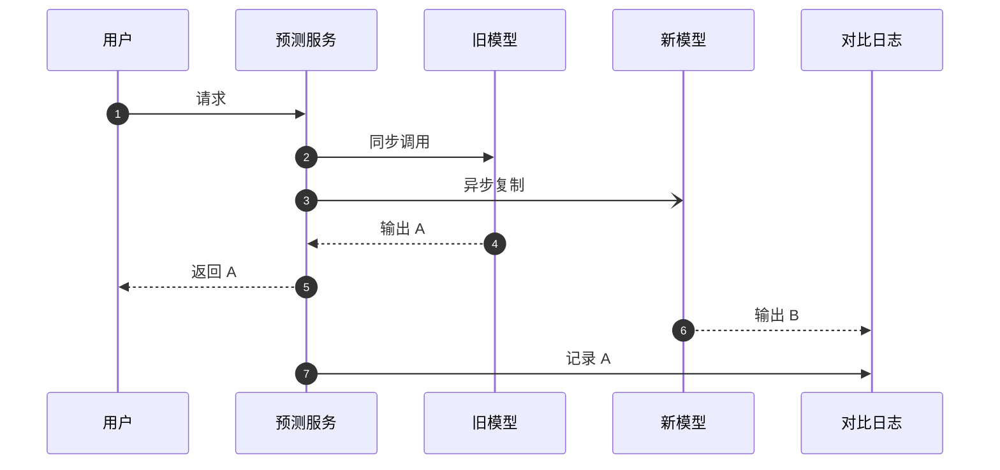

## Q
影子部署具体怎么实现流量复制？对大语言模型做影子部署，比较什么、怎么比较？有哪些坑？

## A
**流量复制的两种做法：**
- **在服务网格里镜像：** Istio 的 `VirtualService` 里写 `mirror: {host: model-v2}` 和 `mirrorPercentage: {value: 10.0}`，Envoy 把 10% 的请求复制一份发给新版本，并丢弃新版本的响应。应用代码不用改。
- **在应用里异步复制：** 预测服务拿到请求后，主路径同步调旧模型；另起一个异步任务把同一请求发给新模型，结果写进日志。好处是能把两边的输出和同一个 `request_id` 对齐。

**大语言模型比较什么：**
- **工程指标：** 新模型的首字延迟、每个词元的间隔、错误率、输出长度分布、因长度上限被截断的比例（`finish_reason=length`）。
- **质量：** 抽样几千对（A，B），让一个评委模型（另一个强大语言模型，按评分规则打分）做成对比较"哪个更好、是否有事实错误、是否拒答"，并人工复核分歧最大的样本。
- **安全：** 新模型的输出过一遍安全分类器，比较违规比例。

**坑：**
- **副作用：** 新模型如果会调用工具（发邮件、下单），影子流量必须换成假的工具接口，否则用户会收到两封邮件。
- **成本：** 大语言模型的影子流量要真的占 GPU。全量复制等于两倍算力，所以通常只复制 5%–10%，或只在低峰时段复制。
- **拖累主路径：** 复制必须是异步、"发出即忘"的，新模型慢或挂掉都不能影响用户的响应时间。
- **采样参数：** 温度大于 0 时同一个模型两次输出也不同，比较时要么用温度 0，要么比较分布而不是逐条比。
- **隐私：** 影子日志里有真实用户输入，存储和访问权限要按生产数据对待。
