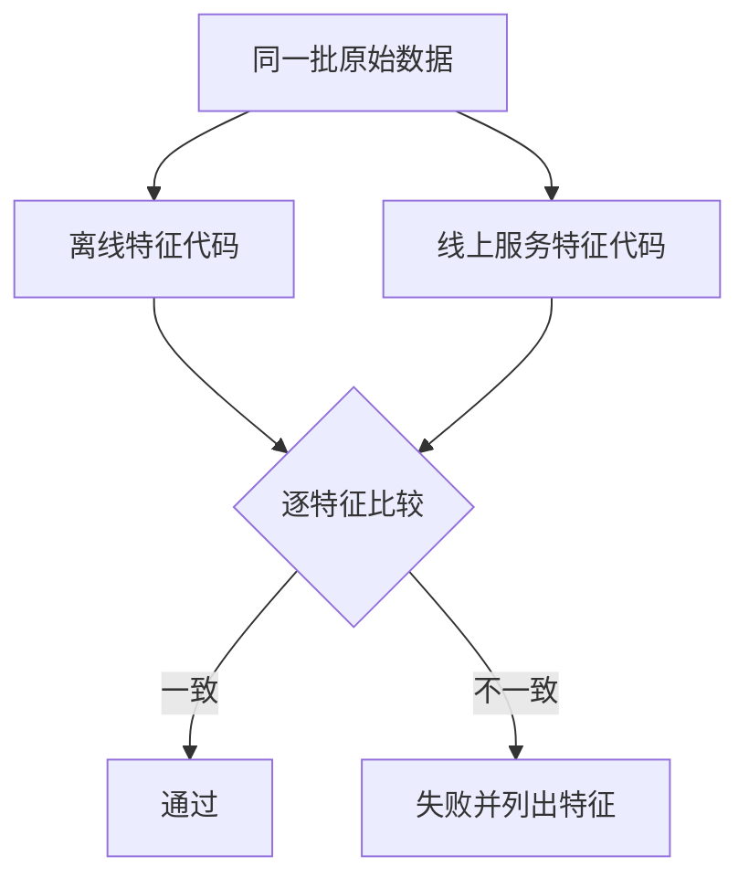

## Q
机器学习的基础设施测试测什么？重点说明"训练与服务一致性测试"（training-serving skew）怎么写，以及模型保存加载、服务契约和端到端冒烟测试。

## A
**训练与服务不一致（training-serving skew）：** 训练时特征由离线的 Python/Spark 代码算，线上由服务里另一份代码（可能是 Java 或 Go）算。两份代码只要有一处不同，模型线上看到的输入就和训练时不一样，效果悄悄变差且不报错。

**一致性测试怎么写：**
1. 从线上预测日志里抽 1,000 条请求，日志里有服务当时算出的特征值。
2. 用离线训练代码，对同样的原始数据重新算这些特征。
3. 逐条、逐特征比较：数值特征 `abs(a - b) <= 1e-6`，类别特征完全相等。
4. 任何特征不一致比例超过 0.1% 就失败，并列出最不一致的特征和样本。

最好的办法是从根上消除：两边共用同一份特征定义（特征存储），或者把前处理打包进模型本身。

**其他基础设施测试：**
- **保存加载往返：** 训练完的模型保存、再加载，对同一批输入的输出应完全一致；换了序列化格式（比如导出成 ONNX）后，输出在容差内一致，如 `numpy.testing.assert_allclose(a, b, rtol=1e-3, atol=1e-5)`。
- **服务契约：** 请求和响应的字段、类型、错误码；缺字段时返回 400 而不是让模型拿默认值乱算。
- **端到端冒烟：** 每次部署后发几条固定请求，检查返回的模型版本是预期的、分数在合理范围、延迟在预算内。
- **训练流水线冒烟：** 用 1% 的数据跑完整条训练流水线（几分钟），确保代码改动没把流水线弄坏；不检查指标，只检查能跑通、产物齐全。
- **可复现：** 固定种子和数据快照，同一配置跑两次，指标差异在很小的范围内。
- **性能：** 单副本在目标并发下的 p99 延迟和吞吐，和上一个版本对比。
