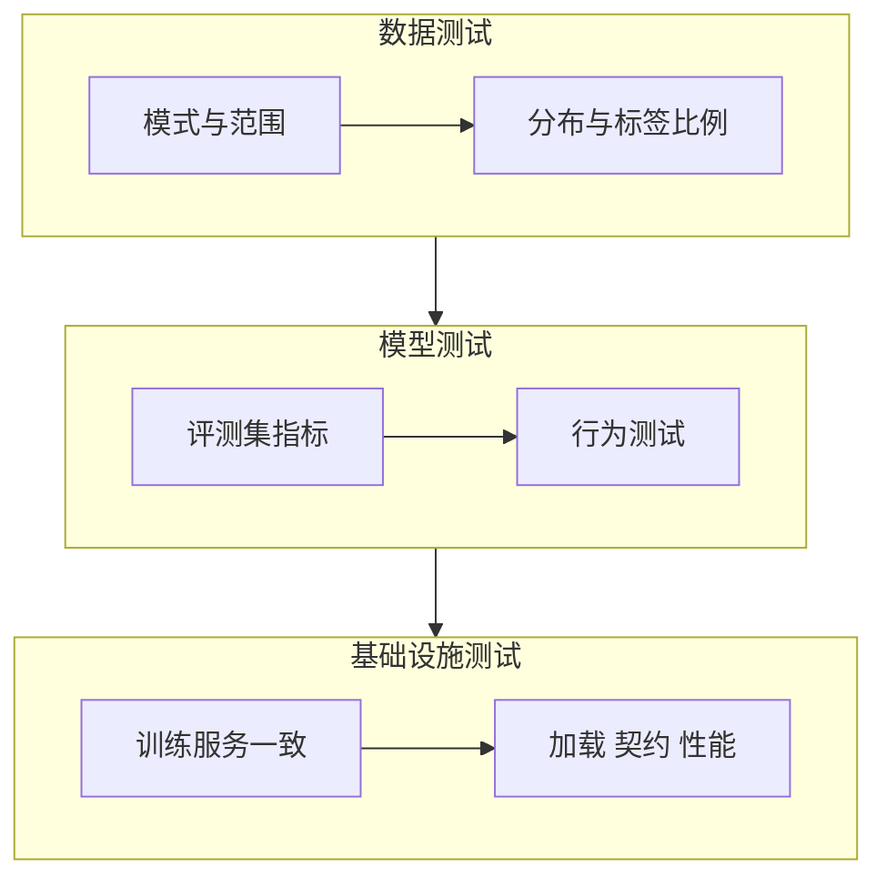

## Q
测试一个机器学习系统，和测试普通软件比多了什么？按数据、模型、基础设施三层，各测什么、在流水线的哪一步跑？

## A
**多出来的东西：** 普通软件的逻辑写在代码里，测试检查代码。机器学习系统的逻辑有一大半是从数据里学出来的、藏在参数里，所以除了测代码，还要测**数据**（喂进去的东西对不对）和**模型**（学出来的行为对不对）。而且模型的"正确"是统计意义上的：允许错一些，但不能错得比以前多。

| 层 | 测什么 | 例子 | 在哪一步跑 |
|---|---|---|---|
| **数据** | 模式（列、类型）、取值范围、空值、分布、标签比例、训练集与评测集不重叠 | "金额不能为负""国家字段的新值比例小于 1%" | 每次数据到达、每次训练前 |
| **模型** | 评测集上的总体和分切片指标；行为测试（换个说法结果不该变、明显的样本必须判对） | "召回率不低于 0.78""把名字换掉不影响情感分类" | 每次训练后、发布前 |
| **基础设施** | 训练和服务的前处理输出一致；模型能保存再加载且输出不变；服务接口契约；延迟和吞吐；训练流水线能端到端跑通 | "同一条样本，训练代码和服务代码算出的特征逐位相等" | 每次代码提交（CI）、发布前 |

**一个有名的清单：** 业界有一份"ML 测试分数"（ML Test Score）的评分表，把生产级机器学习系统需要的测试分成数据、模型、基础设施、监控四类，共 28 项，每项按"手工做过"和"自动化"打分。用它给自己团队打分，能快速找出缺口。

**一个原则：** 能用确定性断言的就别用统计阈值（数据模式、前处理一致性、接口格式）；只有模型质量这种本来就是统计性的东西，才用"不低于基线减容差"的阈值判断。
