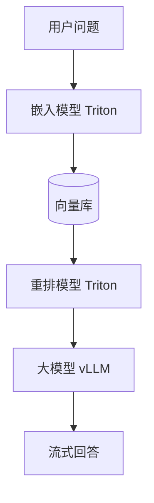

## Q
一个文档问答请求要依次调用嵌入模型、向量检索、重排模型和大语言模型。这种多模型组成的"推理图"应该怎么部署？每个模型各放一个服务，还是放在一个进程里？

## A
**几个词：**
- **嵌入模型**（embedding model）：把一段文字变成一串固定长度的数字（向量），意思相近的文字向量也相近。
- **向量检索：** 在几百万个文档向量里找出和问题向量最近的几十个。
- **重排模型**（reranker）：拿问题和每个候选段落逐对打分，比向量距离更准但更慢。
- **大语言模型：** 读问题加最相关的几段，生成回答。

**一般做法：每个模型独立部署，由一个编排服务串起来。** 理由：
- **资源差别大：** 嵌入和重排模型几百 MB，一张卡能放好几个且每次只要几毫秒；大模型要整卡甚至多卡。放一起会让小模型抢大模型的显存，或者让整卡跟着小模型空转。
- **扩缩容独立：** 重排每个请求要打 50 对分，负载是大模型请求数的 50 倍，副本数应该单独算。
- **独立发布：** 换重排模型不需要重启加载了几十 GB 权重的大模型。

**编排的三种实现：**
- **自己写服务：** 一个普通的 Python 或 Go 服务按顺序调用，最直观，超时和重试自己控制。
- **Ray Serve 组合：** 每一步是一个 deployment，用 `DeploymentHandle` 互相调用，每步单独设副本数和 `num_gpus`。
- **KServe `InferenceGraph` 或 Triton 集成（ensemble）：** 用配置描述步骤顺序；Triton 的集成适合同一台机器上的前后处理与模型串联，省掉网络往返。

**什么时候放一起：** 两个步骤之间传的数据很大（比如整张图片的中间特征）、或者调用极其频繁且每次只要 1 ms，网络往返的开销就比计算还大，这时放在同一进程或同一 Pod 更划算。

**延迟账：** 嵌入 10 ms + 检索 20 ms + 重排 50 ms + 大模型首字 300 ms，首字约 400 ms。最慢的是大模型，所以优化先看它，别在 10 ms 的步骤上费劲。
