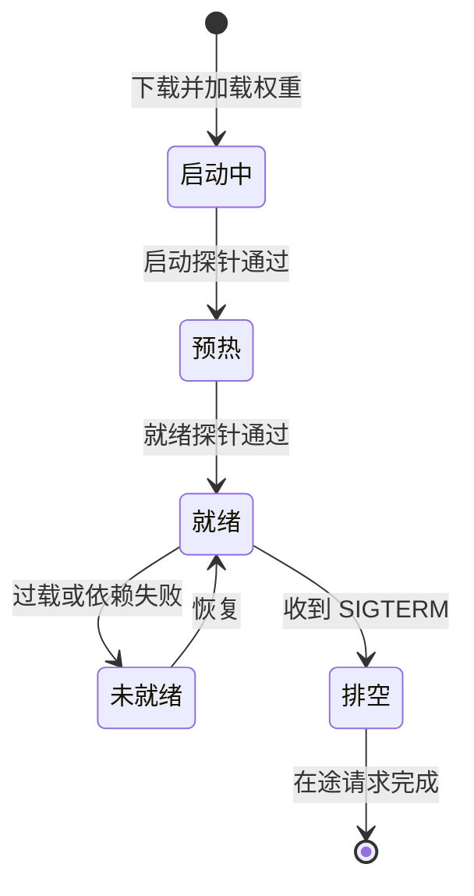

## Q
新的模型服务 Pod 一启动就开始收流量，前几分钟大量请求超时或报错。原因可能是什么？Kubernetes 的三种探针应该怎么给模型服务配置？

## A
**原因：** 进程起来了不等于模型能用。一个 70 亿参数（7B）的模型，权重（模型学到的参数）用 16 位存是约 14 GB，要从对象存储下载、读进内存、拷进 GPU 显存，再跑几次预热计算（让 GPU 编译好要用的计算程序），整个过程可能要 1–5 分钟。如果探针只检查"HTTP 端口能连上"，Pod 在权重还没加载完时就被加进负载均衡，请求全部失败或排队超时。

**三种探针各管一件事：**
- **启动探针（`startupProbe`）：** 给慢启动留时间。比如每 10 秒检查一次 `/health`，`failureThreshold: 60`，即最多等 10 分钟；在它成功之前，另外两个探针不生效，Pod 不会因为"启动慢"被误杀重启。
- **就绪探针（`readinessProbe`）：** 决定能否接流量。必须检查"模型已加载并能推理"，例如 Triton 的 `/v2/health/ready` 只在模型加载完成后返回 200；vLLM 的 `/health` 在引擎就绪后才返回 200。更严格的做法是让就绪检查真的跑一次很短的推理。
- **存活探针（`livenessProbe`）：** 决定要不要重启。只检查进程没卡死，别在里面跑推理：推理在高负载下变慢，会让存活探针超时，Kubernetes 重启 Pod，剩下的 Pod 负载更高，接着一个个被重启，形成雪崩。

**其他配置：**
- **优雅下线：** 收到 SIGTERM 后先让就绪探针失败、停止接新请求，等在途的生成完成再退出；`terminationGracePeriodSeconds` 要大于最长请求时长，比如 300 秒。
- **滚动发布：** `maxUnavailable: 0`、`maxSurge: 1`，新 Pod 就绪了才下老 Pod，保证容量不掉。
- **预热请求：** 就绪前用几条不同长度的输入跑一遍，避免第一个真实用户触发编译而慢几秒。
