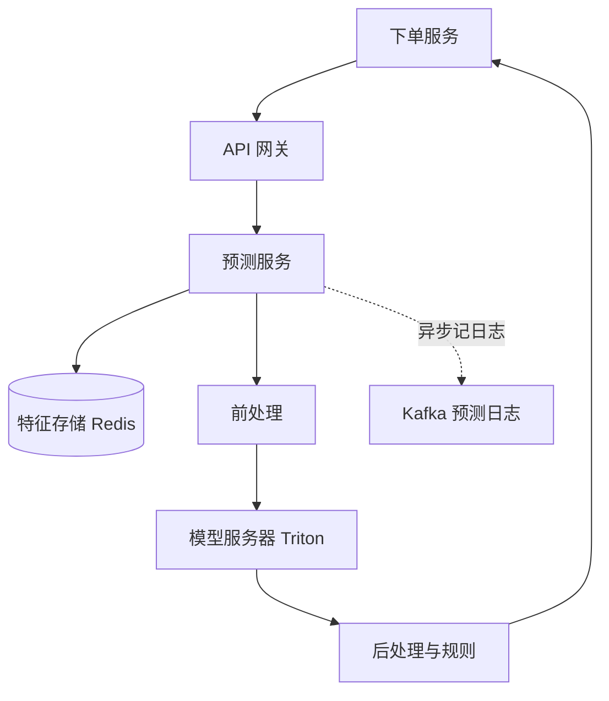

## Q
一次在线预测请求从进入系统到返回结果，要经过哪些组件？每个组件做什么？以"下单时判断是否欺诈"为例。

## A
**几个词：** **特征**（feature）是喂给模型的输入数字，比如"这张卡过去 1 小时刷了几次"；**模型服务器**（model server）是专门把模型加载进内存（或 GPU 显存）、接收输入、跑模型、返回输出的进程。

**逐个组件：**
1. **API 网关：** 鉴权、限流、按模型名路由，并给请求打上 `request_id`。
2. **预测服务：** 业务逻辑的主人。它知道这个模型要哪些特征，按 `card_id` 去特征存储批量读取，读不到的用默认值并打标记。
3. **前处理：** 把原始字段变成模型要的格式，比如金额取对数、类别转编号。这一步必须和训练时用的是**同一份代码**，否则模型线上看到的数和训练时不一样。
4. **模型服务器：** 加载好的模型跑一次前向计算（输入从第一层算到最后一层），返回一个 0 到 1 的欺诈分数。
5. **后处理与规则：** 分数大于 0.9 拦截，0.6–0.9 要求短信验证；再叠加硬规则，比如黑名单直接拦。
6. **预测日志：** 把（`request_id`，特征，分数，模型版本）异步写进 Kafka，用于之后和真实结果（是否拒付）对齐、监控和再训练。不能同步写，免得日志系统慢拖慢下单。

**延迟预算举例（总共 50 ms）：** 网关 2 ms，读特征 5–10 ms，前处理 2 ms，模型 5–15 ms，后处理 1 ms，余下留给网络和排队。
