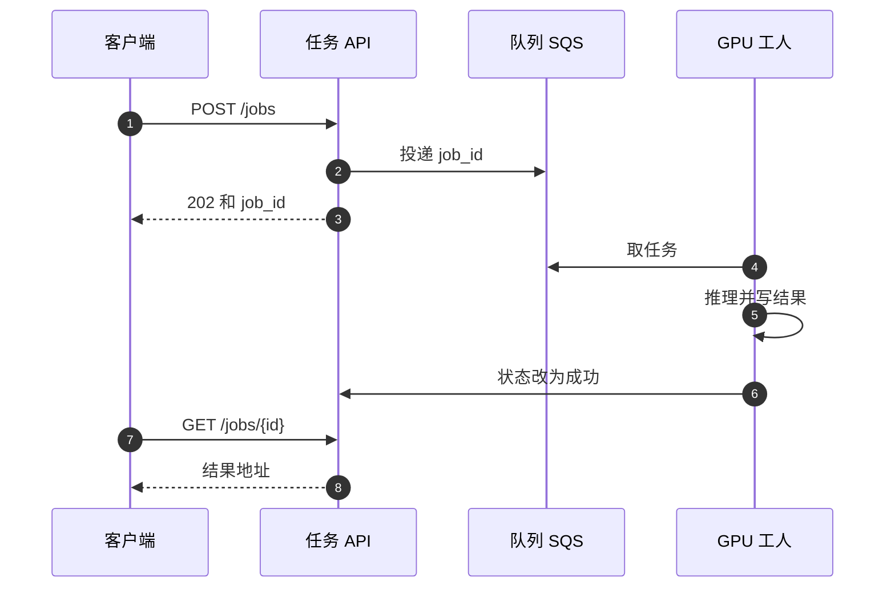

## Q
模型服务的接口可以是同步请求-响应、异步任务、或流式返回。三种分别适合什么样的模型和耗时？各自的接口长什么样？

## A
**按"一次预测要多久"来选：**

| 方式 | 适合耗时 | 例子 | 接口形状 |
|---|---|---|---|
| **同步** | 几毫秒到约 1 秒 | 欺诈打分、推荐排序、文本嵌入 | `POST /predict` 直接返回结果 |
| **流式** | 几秒到一两分钟，但要边算边看 | 大模型聊天 | `POST /v1/chat/completions` 带 `"stream": true`，用 SSE（server-sent events，服务器在一个 HTTP 响应里持续推送多段数据）逐段返回 |
| **异步** | 几十秒到几小时 | 文生视频、给一万篇文档做摘要 | `POST /jobs` 返回 `job_id`，客户端轮询 `GET /jobs/{id}` 或等回调 webhook |

**为什么大模型聊天要流式：** 大语言模型一次只生成一个**词元**（token，大约是一个汉字或半个英文单词），生成 500 个词元、每个 20 ms，总共要 10 秒。同步接口要用户盯着空白等 10 秒；流式在约 0.5 秒后就出现第一个字，之后每 20 ms 出一个，体验完全不同。

**异步任务的组件：**
- **任务表：** `job_id`、状态（queued / running / succeeded / failed）、输入位置、输出位置。
- **队列：** API 只负责把任务写进表并投递到队列（SQS、Kafka），立刻返回 202。
- **工人：** GPU 上的工人从队列取任务，跑完把结果写对象存储，再更新状态。
- **工人死掉：** 靠队列的可见性超时（SQS 的 visibility timeout）或租约过期，任务重新出现在队列里被别的工人取走；输出路径按 `job_id` 固定，重做不会产生两份结果。

**常见错误：**
- **同步接口包长任务：** 30 秒的任务走同步接口，会撞上负载均衡器的空闲超时（AWS ALB 默认 60 秒），连接被切断但 GPU 还在白算。
- **流式没处理断开：** 用户关掉页面后服务端没有停止生成，GPU 继续为没人看的回答干活。服务端必须监听连接断开并通知引擎中止该请求。
