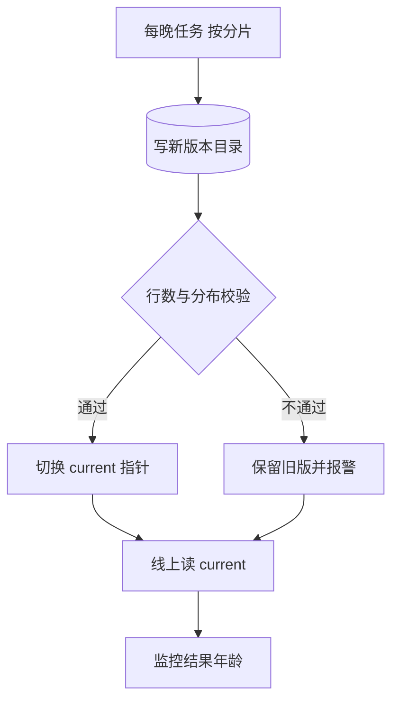

## Q
批量预测任务凌晨跑失败了，或者只跑完一半，线上会发生什么？怎样设计才能让这种失败被发现、可恢复，而且不把半成品发出去？

## A
**典型事故：** 凌晨的推荐任务因为上游数据表没就绪而失败，没人发现。白天线上一直读到前天的结果，点击率慢慢下降，三天后才有人从业务报表里看出来。批量的失败是**安静的**：服务不报错，只是结果变旧。

**设计要点：**
- **结果带版本，原子切换：** 每次任务把结果写到新的位置，例如 `recs/2026-11-13/`；全部写完、校验通过后，再把指针 `recs/current` 一步切过去。读路径只读指针指向的版本，永远不会读到半成品。
- **校验再发布：** 切换前检查行数（比如不能少于昨天的 95%）、空值比例、分数分布是否和昨天接近。不过就不切，保留旧版本并报警。
- **新鲜度监控：** 每行结果带 `computed_at`，监控"当前在用版本的年龄"，超过 26 小时就报警。这比监控"任务是否成功"更可靠，因为任务也可能"成功地"写出了空结果。
- **分片与幂等：** 把 1 亿用户切成 1,000 个分片，每片单独可重跑；输出路径由（日期，分片号）唯一确定，重跑覆盖同一路径，结果不重复。编排器（Airflow、Argo Workflows）只重跑失败的分片。
- **降级读旧版：** 新版没就绪时继续用昨天的结果，并在接口里返回结果的年龄，让调用方决定要不要改走在线模型。

**大模型批量任务的特殊点：**
- **单条可能很慢：** 一条超长输入可能跑几分钟；按条设超时，超时的单独记下来重试，别让一条拖住整片。
- **部分失败是常态：** 1,000 万条里有几千条报错（输入超长、内容被拒）。按条记录状态，最后交付"成功结果 + 失败清单"，而不是整批失败。
- **断点续跑：** 已完成的条目按 `request_id` 记录，重启后跳过，避免重复花钱。
