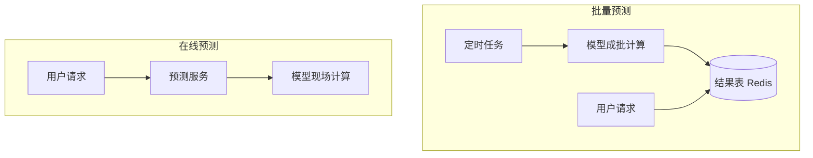

## Q
模型对外提供预测有两种方式：批量预测（batch prediction）和在线预测（online prediction）。两者各是怎么工作的？用一个推荐场景和一个大模型场景各举一例。

## A
先说词：**模型**是一个带参数的函数，输入一些数，输出一个预测；**推理**（inference）就是用训练好的参数跑一次这个函数。两种服务方式的区别只在于**什么时候跑**。

- **批量预测：提前算好存起来。** 定时任务（例如每天凌晨 2 点）把所有用户的输入一次读出来，成批送进模型，结果写进键值库。请求来时只查表，不跑模型。
- **在线预测：请求来了才算。** 请求带着输入到达预测服务，服务现场取特征、调模型、返回结果，整个过程要在请求的延迟预算内完成。

**例子。**
- **推荐（批量）：** 每晚为 1 亿个用户各算 100 个推荐商品，存到 Redis，打开首页时按 `user_id` 读出。
- **推荐（在线）：** 用户刚点了"跑鞋"，下一屏马上要出相关商品，必须带着这次点击现场算。
- **大模型（批量）：** 给 1,000 万篇商品评论各生成一句摘要，第二天交付即可。用离线脚本把请求成批喂给推理引擎，或用模型提供商的批处理接口。
- **大模型（在线）：** 聊天应用里用户提问，回答要一个字一个字马上流出来。

**判断口诀：** 输入能不能提前知道？结果能不能晚一些？两个都是"能"，就用批量；否则用在线。
