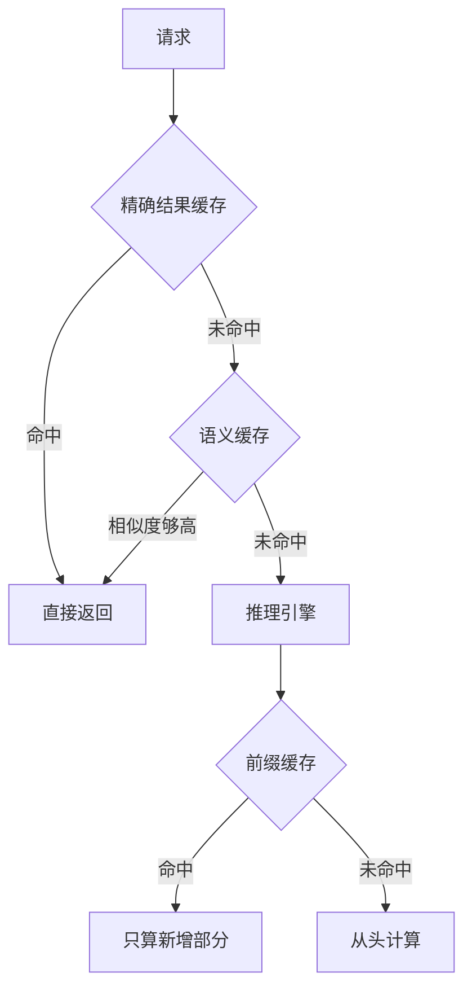

## Q
模型服务里可以在几个层次上做缓存：精确结果缓存、语义缓存、前缀缓存、提示缓存。它们分别缓存什么、用什么做键、命中后省掉什么？

## A
以一个客服聊天机器人为例，每个请求是"一段固定的系统说明（约 2,000 词元）+ 用户问题"。**词元**（token）约等于一个汉字或半个英文单词。

| 层 | 缓存什么 | 键 | 命中省掉什么 |
|---|---|---|---|
| **精确结果缓存** | 整个回答 | 模型版本 + 完整输入 + 采样参数的哈希 | 整次推理 |
| **语义缓存** | 整个回答 | 问题的向量（把句子变成一串数字，意思相近的数字也相近），按相似度查 | 整次推理，但可能答非所问 |
| **前缀缓存** | 引擎内部对开头那段输入的计算结果（KV 缓存：模型处理过的每个词元在每一层留下的中间结果） | 开头那段词元的哈希 | 这段输入的重复计算，首字更快 |
| **提示缓存（服务商）** | 同前缀缓存，由模型服务商在其服务端做 | 由服务商按前缀匹配 | 首字延迟与输入费用，命中部分按更低价格计费 |

**适用场景：**
- **精确结果缓存：** 只在温度为 0（每步都选概率最高的词元，输出基本固定）且输入高度重复时有效，比如"把这个商品 ID 翻译成标题"。聊天场景命中率通常很低。
- **语义缓存：** 适合常见问题（"怎么退货""运费多少"），命中率可能有 20–40%，但必须严格控制相似度阈值。
- **前缀缓存：** 几乎总该开（vLLM 的 `--enable-prefix-caching`），系统说明和多轮对话的历史都是重复前缀。它只省计算，不改变输出，没有"答错"的风险。
- **提示缓存：** 调用外部服务商时，把不变的部分放在最前面，变化的部分放后面，才能命中。

**设计原则：** 越靠前的层省得越多，但越可能返回不合适的答案；越靠后越安全。
