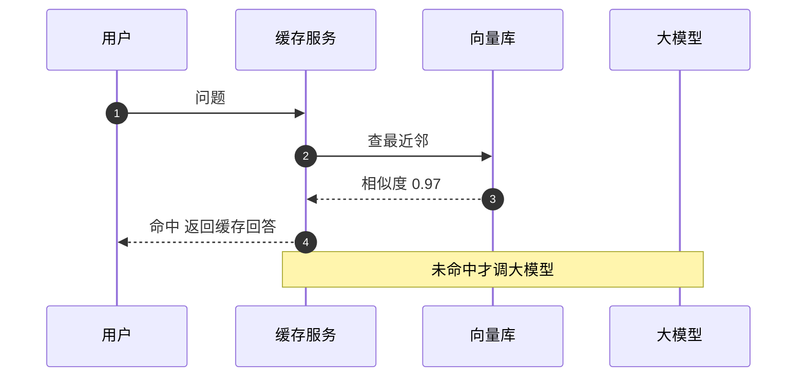

## Q
语义缓存（semantic cache）是怎么工作的？相似度阈值怎么定？它最危险的错误是什么，怎样防？

## A
**机制：**
1. **嵌入：** 新问题先经过一个嵌入模型（embedding model），变成一个固定长度的向量，比如 768 个数。意思相近的句子，向量方向也接近。
2. **查近邻：** 在向量库（Redis 向量索引、FAISS、pgvector）里找和它最近的历史问题，相似度用余弦相似度（两个向量夹角的余弦，1 表示方向完全一样）。
3. **判定：** 最高相似度超过阈值（比如 0.95）就返回那个历史问题的回答；否则调用大模型，把（问题向量，回答）写进缓存。

**阈值怎么定：** 从真实日志抽 1,000 对"相似度在 0.85–0.99 之间"的问题，人工标注"能否用同一个回答"。画出每个阈值下的命中率和错误率，选错误率低于 1% 的最低阈值。阈值不能拍脑袋，不同嵌入模型的分数分布差别很大。

**最危险的错误：意思相近但答案不同。**
- **"怎么取消订单"和"怎么不取消订单"** 向量可能非常接近。
- **"北京明天天气"和"上海明天天气"** 只差一个城市名。
- **带个人信息的问题** "我的订单到哪了"，答案因人而异，绝不能共享。

**防护：**
- **键里加上下文：** 只在同一租户、同一模型版本、同一系统提示内查缓存，绝不跨租户共享回答。
- **白名单场景：** 只对 FAQ 类意图开启（先用分类器判断意图），涉及个人数据、时间敏感或包含数字实体的问题不走缓存。
- **过期：** 每条缓存设 TTL（比如 24 小时）；模型或知识库更新时清空对应命名空间。
- **监控：** 抽样命中的请求，让评委模型或人工判断"回答是否适合这个问题"，错误率超标就提高阈值或关闭。

**收益估算：** 命中率 30%，每次大模型调用 1 秒、0.002 美元，嵌入加查询约 20 ms。那么 30% 的请求从 1 秒降到 20 ms，大模型费用省 30%。
