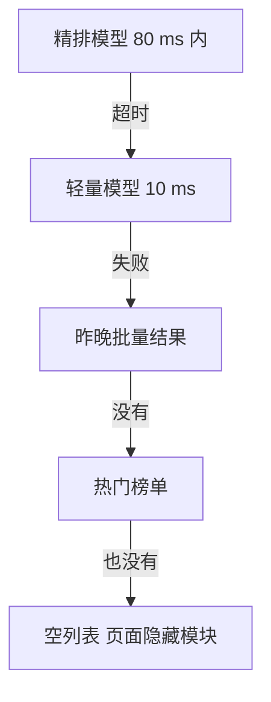

## Q
模型服务超时或不可用时，应该怎样降级？超时怎么设、降级阶梯怎么排？以推荐服务和大模型聊天各举一例。

## A
**先设截止时间（deadline），再逐层传递：** 调用方给整个请求一个总预算，比如推荐首页 100 ms。网关把剩余时间放进请求头，下游每一层用"剩余时间减去自己的开销"作为调用下一层的超时。这样不会出现上层已经放弃、下层还在白算的情况。gRPC 原生支持 deadline 传递。

**推荐服务的降级阶梯：**

每下一级更快、更稳、但更不个性化。热门榜单可以放在本地内存，几乎不会失败。

**大模型聊天的降级阶梯：**
1. **主模型：** 自建的 70B 模型。
2. **同模型另一个集群或区域：** 主集群排队超过阈值时转过去。
3. **小一号的模型：** 8B 模型，回答质量低一些但能用；在界面上标明"当前为快速模式"。
4. **外部服务商：** 另一家的接口作为最后备份，前提是合规允许把数据发出去。
5. **友好报错：** 返回 503 和 `Retry-After`，而不是让用户等 2 分钟后超时。

**大模型的超时要分两段设：**
- **首字超时：** 比如 10 秒内没有第一个词元，就放弃并切下一级。此时还没给用户输出任何东西，切换对用户无感。
- **生成中途：** 已经流出一半回答再切模型，会出现前后风格不一致。一般不切，而是给出"回答中断，请重试"。

**熔断器（circuit breaker）：** 某个下游连续失败（比如 10 秒内错误率超过 50%），就直接走降级、不再调用它，每隔几秒放一个探测请求试探是否恢复。防止所有请求都卡在超时上，把调用方的线程和连接耗尽。

**一定要监控降级率：** 降级让用户看不到错误，也让团队看不到。降级比例从 0.1% 升到 20% 时必须报警，否则可能连续几天在用热门榜单而没人发现。
