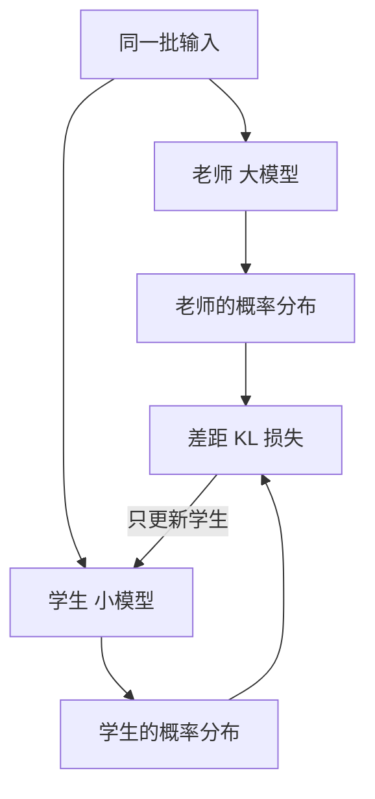

## Q
知识蒸馏（knowledge distillation）是怎样让小模型学大模型的？什么是"软标签"和"温度"？大语言模型的蒸馏一般怎么做？

## A
**角色：** 老师（teacher）是已经训练好的大模型，学生（student）是要训练的小模型。

**普通训练只用"硬标签"：** 一张猫的图片，标签就是"猫"。模型输出每个类别的分数，经过 softmax（把一组分数变成加起来等于 1 的概率）后，训练让"猫"的概率尽量接近 1。

**蒸馏多用了"软标签"：** 让老师先看同一张图，输出比如"猫 0.90、狗 0.08、汽车 0.0001"。这组概率比单个"猫"多了信息：猫和狗很像，和汽车完全不像。学生被训练成**输出和老师一样的概率分布**，学到的东西比硬标签多。

**温度（temperature）：** 把老师的分数先除以一个数 T 再做 softmax。T = 1 时"狗 0.08"这种小概率太小，学生学不到；T = 4 时分布被摊平，小概率被放大，类别之间的相似关系更明显。训练时老师和学生用同一个 T，部署时学生用回 T = 1。

**损失怎么写：** 总损失 = a × 学生和真实标签的交叉熵 + (1 − a) × 学生和老师软分布的差距（KL 散度，衡量两个概率分布差多少）。

**一个数字：** DistilBERT 把 BERT 蒸馏成小 40% 的模型，推理快约 60%，保留约 97% 的语言理解能力。

**大语言模型的两种蒸馏：**
- **对数分布：** 每生成一个位置，都让学生的"下一个词元概率分布"贴近老师的。需要能拿到老师每一步的完整概率（logits，模型对每个候选词元打的原始分数），所以只能用自己能跑的老师模型。
- **用老师生成的数据：** 让大模型对几十万条指令写出好回答，再用这些问答对微调小模型。只要老师的输出文字，工程上最常用。

**风险：** 学生只会老师在蒸馏数据里展示过的能力。蒸馏数据里没有的语言、代码类型或长文档，学生可能明显变差，所以要按切片（语言、任务类型、长度）分别评测，而不是只看总分。
