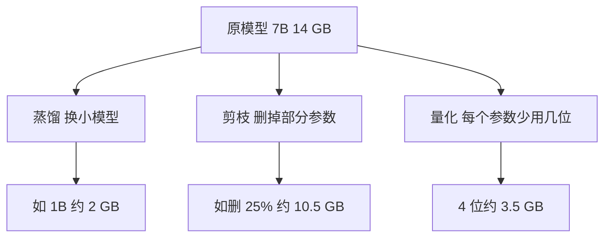

## Q
让模型更小、更快的三种办法是蒸馏、剪枝和量化。它们分别改变了模型的什么？用一个 70 亿参数（7B）的模型说明各自能省多少。

## A
**先说参数：** 模型是一个带参数的函数，"7B"指它有 70 亿个参数（学到的数字）。每个参数用 16 位（2 字节）存，权重就是 14 GB。推理时每生成一个词元，GPU 要把这 14 GB 从显存读一遍，所以**模型越小，读得越少，越快越省**。

| 方法 | 改了什么 | 7B 的例子 | 代价 |
|---|---|---|---|
| **蒸馏**（distillation） | 换一个更小的模型，让它学着模仿大模型的输出 | 训练一个 1B 学生，权重约 2 GB | 要重新训练，花大量算力；小模型能力有上限 |
| **剪枝**（pruning） | 删掉不重要的参数、整层或整个通道 | 删 25% 的宽度，约 10.5 GB | 通常还要再训练一会儿恢复精度；不规则地删很难真的变快 |
| **量化**（quantization） | 参数个数不变，每个参数用更少的位存 | 16 位降到 4 位，约 3.5 GB | 数值变粗，精度可能掉，尤其在难任务上 |

**怎么选：**
- **最便宜、最先试：** 量化。不用重新训练，几小时就能做出一个版本（具体格式和验证方法在量化专题里讲）。
- **要大幅缩小且有训练资源：** 蒸馏。例如把 70B 的能力尽量压进 8B，延迟和成本降一个数量级。
- **结构化剪枝加蒸馏：** 先按层或宽度剪，再用蒸馏把精度补回来，比从零训练小模型便宜。

**三者可以叠加：** 先蒸馏出小模型，再量化到 8 位或 4 位部署。每叠一步都要重新跑同一套评测，确认质量还在可接受范围内。
