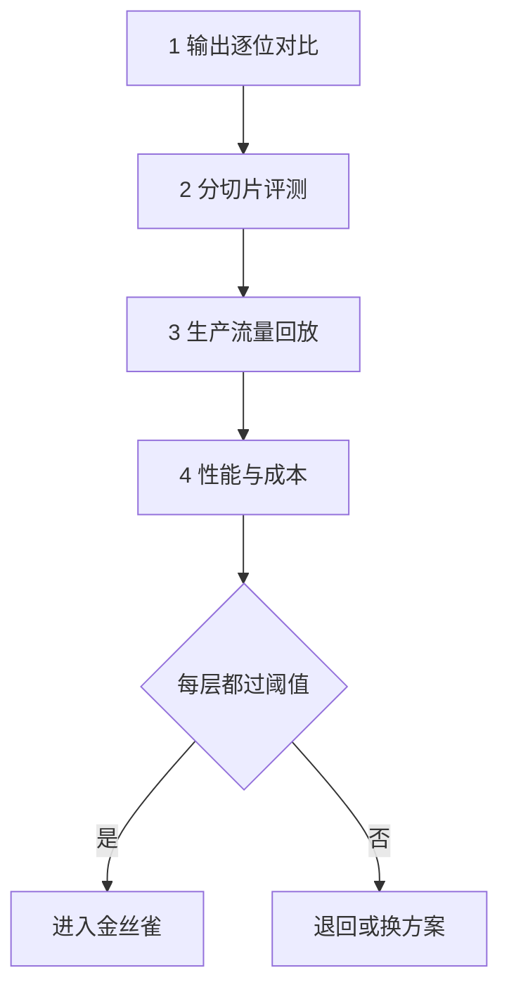

## Q
一个压缩后的模型在公开评测集上总分只掉了 0.5 个百分点，团队准备上线。上线后却有用户投诉代码题和小语种明显变差。为什么总分没发现？压缩模型上线前应该怎样验证？

## A
**为什么总分骗人：** 总分是所有题的平均。假设评测集里 90% 是英文常识问答，压缩后只掉 0.1 个百分点；5% 是代码，掉了 5 个点；5% 是小语种，掉了 4 个点。加权平均：0.9 × 0.1 + 0.05 × 5 + 0.05 × 4 ≈ 0.5 个点，看起来"差不多"，但写代码和用小语种的用户感受到的是成倍的变差。压缩丢掉的往往是**少见能力**，因为它们在模型里占的"份量"小，最先被牺牲。

**验证分四层：**

1. **输出对比：** 同一批输入，比较原模型和压缩模型在每个位置给出的词元概率是否接近，比如概率最高的词元一致的比例（top-1 一致率）要高于 98%。这一层最快，能在几分钟内抓到严重错误。
2. **分切片评测：** 按任务类型（问答、代码、数学、长文档）、语言、输入长度分别算分，**每个切片单独设阈值**，比如任何切片下降都不能超过 2 个百分点。
3. **生产流量回放：** 抽 1 万条真实请求（去掉隐私信息），两个模型都跑一遍，用另一个模型当评委成对比较"哪个回答更好"，并人工抽查分歧最大的 100 条。
4. **性能与成本：** 用同样的负载压测，确认真的变快、变省；有的压缩方式在小批量下快、在大批量下反而慢。

**上线方式：** 先影子部署（复制流量给新模型，但回答不返回给用户）比较一周，再小流量金丝雀，同时监控用户的"重新生成"率和差评率。

**常见坑：** 只用压缩时校准过的那批数据来评测，等于用考试题复习，分数虚高；评测集要和校准、蒸馏用的数据分开。
