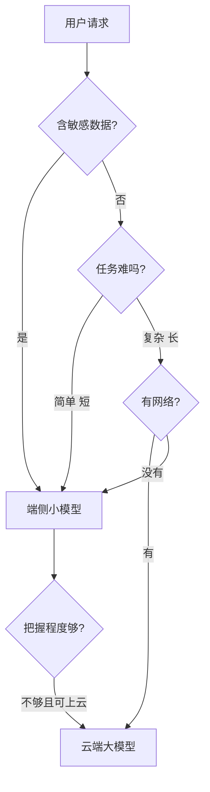

## Q
端侧和云端在延迟、隐私、成本、更新难度上各有什么优劣？什么是"端云协同"，路由规则怎么定？

## A
| 维度 | 端侧 | 云端 |
|---|---|---|
| **延迟** | 没有网络往返，小模型几十毫秒出结果；弱网和离线也能用 | 多一次网络往返（几十到几百毫秒），但大模型算得快 |
| **隐私** | 数据不出设备，合规简单 | 数据要上传，需要加密、留存策略和合规审查 |
| **成本** | 计算花的是用户的电和芯片，服务方几乎零边际成本 | 每次请求都花 GPU 钱，按量增长 |
| **能力** | 受内存限制，只能放小模型 | 可以用最大最强的模型 |
| **更新** | 要等用户更新 App 或下载新模型；线上同时存在很多旧版本 | 服务端一换全换，几分钟回滚 |
| **可观测** | 只能靠用户同意上报的遥测 | 每次请求都有完整日志和指标 |

**端云协同（hybrid）：** 设备上放一个小模型，云端放一个大模型，按规则决定每个请求在哪算。

**路由规则的几种依据：**
- **任务类型：** 改错别字、短回复建议在端侧；长文总结、复杂推理上云。
- **把握程度：** 端侧模型先答，自己判断没把握（比如输出概率低）时再上云。
- **隐私标签：** 含健康、支付等敏感内容的强制端侧，或上云前先脱敏。
- **设备能力：** 低端机内存不够就全部上云。

**难点：**
- **版本矩阵：** 线上同时存在多个 App 版本 × 多个模型版本 × 多种芯片，测试要覆盖这个组合，而不是只测最新版。
- **结果不一致：** 同一句话端侧和云端答得不一样，用户会困惑；要让两边的提示格式、安全规则保持一致。
- **云端兜底容量：** 端侧模型出问题时如果大量请求回退到云端，云端要有能接住的容量，或者要能限流。
