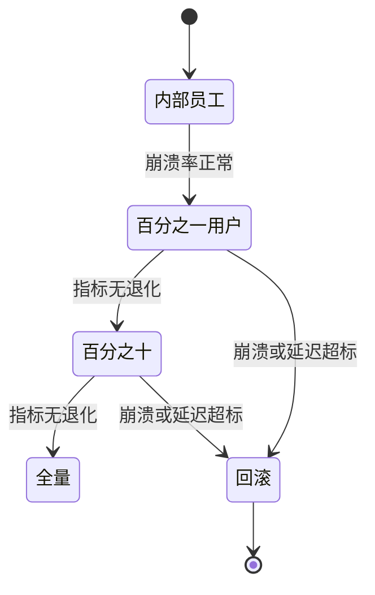

## Q
一个新版本的端侧模型要推送给几千万台手机。可能出什么问题？怎样测试和分阶段发布，出了问题怎么回滚？

## A
**典型事故：**
- **某型号崩溃：** 新模型用了一个算子，某款旧芯片的 NPU（神经网络专用处理器）不支持，退回 CPU 后慢 10 倍，或者直接让 App 闪退。
- **内存超限：** 新模型大了 300 MB，在 6 GB 内存的手机上被系统强杀，用户只看到"App 闪退"。
- **数值不一致：** 同一个模型在不同芯片上计算精度不同，某些机型输出质量明显变差。
- **下载失败：** 1.5 GB 的模型在弱网下载到一半中断，留下损坏的文件，下次启动加载失败。

**测试：**
- **真机矩阵：** 按用户量排出覆盖 90% 用户的机型和系统版本，在设备云（如 Firebase Test Lab、AWS Device Farm）或自有机架上跑：加载时间、首次推理延迟、内存峰值、连续运行 10 分钟后的温度与降频。
- **输出对比：** 同一组 500 条输入，在每种芯片上的输出和服务器上的参考输出比较，差异超过阈值就标出该机型。
- **文件完整性：** 下载后校验 SHA-256，校验失败就删除重下，加载失败自动回到上一个模型。

**分阶段发布：**

- **服务端控制开关：** 模型下发由服务端的配置决定（按机型、App 版本、地区、用户百分比），不是写死在 App 里。
- **看的指标：** 崩溃率、模型加载失败率、推理延迟 p95、端侧回退到云端的比例、用户接受率（比如键盘建议被采纳的比例）。
- **回滚：** 设备上保留上一版模型文件；服务端把配置改回旧版本，设备下次拉配置就切回，不用等 App 更新。某个机型有问题时，只对这个机型关掉新模型或强制走云端。
