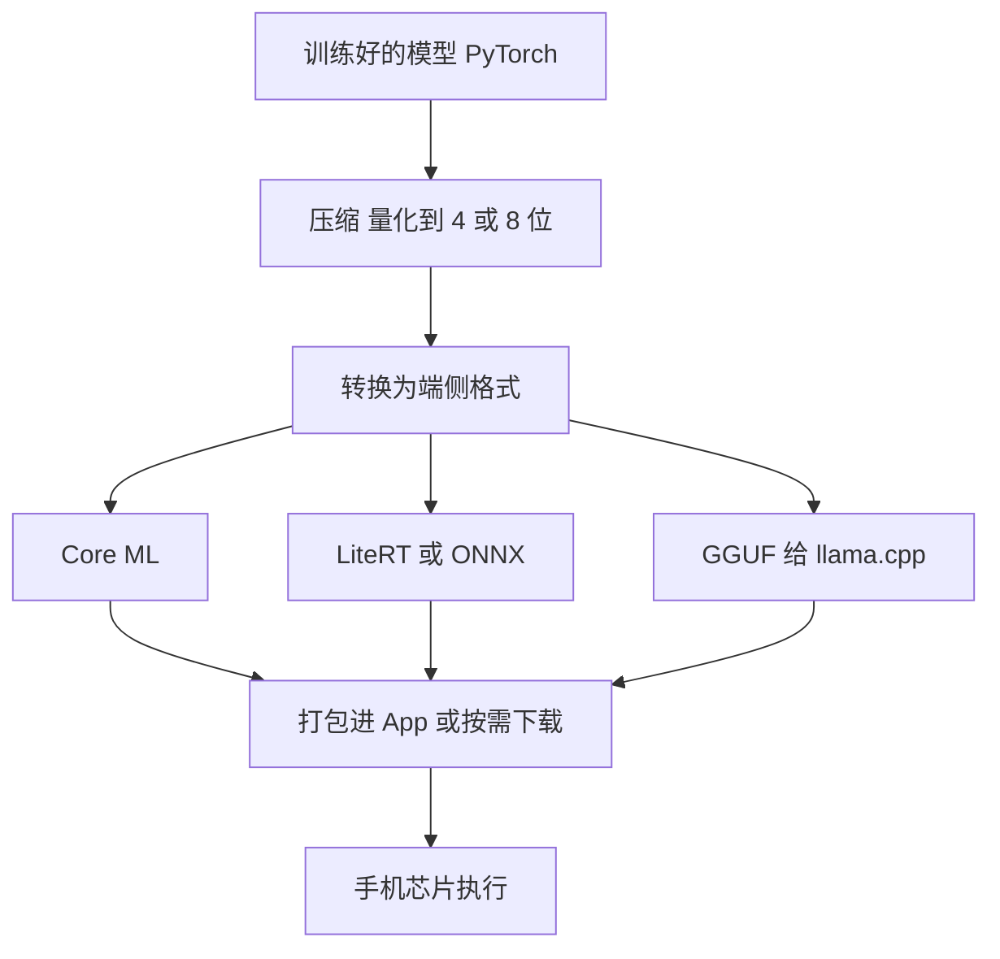

## Q
端侧推理（on-device / edge inference）和云端推理有什么区别？一个模型要放到手机上跑，从训练好到在手机里运行要经过哪些步骤、用到哪些工具？

## A
**区别只有一句：** 云端推理是手机把输入发给服务器、服务器上的 GPU 跑模型再把结果发回来；端侧推理是模型文件装在手机（或浏览器、汽车、摄像头）里，在本机的处理器上直接算，不需要网络。

**典型端侧例子：** 相册里的人脸分组、键盘的下一个词预测、离线语音识别、相机的实时美颜，以及手机自带的几十亿参数的小语言模型。

**步骤与工具：**
1. **压缩：** 手机内存只有 8–16 GB 且要和其他 App 共享，模型通常量化（每个参数用更少的位存）到 8 位或 4 位。一个 30 亿参数的模型用 4 位存约 1.5 GB。
2. **转换格式：** 苹果设备用 Core ML（`coremltools` 转换），安卓常用 LiteRT（原 TensorFlow Lite）或 ONNX Runtime Mobile，大语言模型常转成 GGUF 格式给 llama.cpp，浏览器里可以用 WebGPU 跑（如 WebLLM）。
3. **选执行单元：** 运行时把计算分给 CPU、GPU 或 NPU（神经网络专用处理器，做矩阵乘法省电）。不是所有算子 NPU 都支持，不支持的部分会退回 CPU，可能慢很多。
4. **分发：** 小模型直接打进 App；大模型首次使用时再下载，并支持之后单独更新模型文件，不用发新版 App。
5. **在真机上测：** 延迟、内存峰值、发热、耗电，要在高中低端几种真机上分别测，模拟器不算数。
