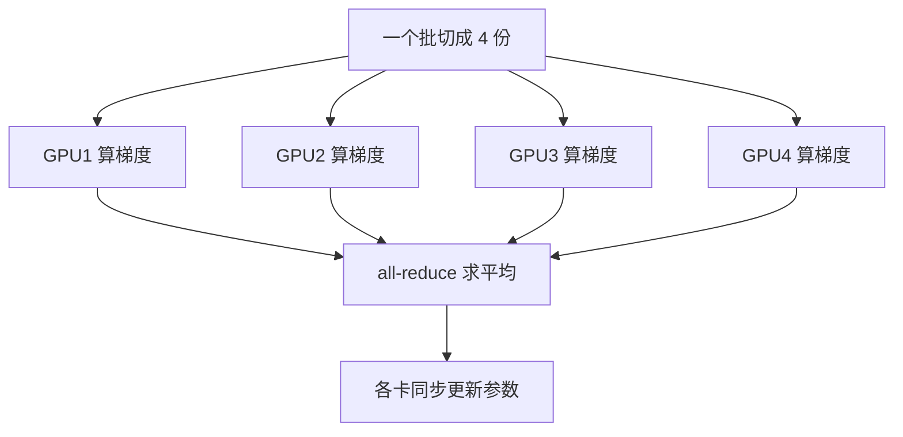

## Q
为什么大模型训练必须用多块 GPU？数据并行（data parallelism）是怎么工作的？用 7B 模型的显存账说明它什么时候不够用。

## A
**训练要存的远不止参数**。用 Adam 优化器（一种为每个参数维护两个统计量的梯度下降方法）和混合精度（大部分计算用 16 位数，主权重用 32 位保存）训练时，每个参数大约要：
- 16 位权重 2 字节 + 16 位梯度 2 字节（梯度：参数该往哪个方向改的数）；
- 32 位主权重 4 字节 + Adam 的两个统计量各 4 字节 = 12 字节。
- 合计约 **16 字节 / 参数**。

**7B 模型**：70 亿 × 16 字节 = **112 GB**，还没算激活值（前向计算的中间结果，反向时要用）。一块 H100 只有 80 GB 显存，一块卡放不下。

**数据并行**：每块 GPU 放一份完整的模型，各自处理不同的数据。
1. 一个全局批（batch，一次更新用的一组样本）切成 N 份，每块卡一份。
2. 每块卡各自做前向和反向计算，得到自己那份数据的梯度。
3. 所有卡做一次 **all-reduce**（每块卡最终都拿到所有卡梯度的平均值）。
4. 每块卡用同样的平均梯度更新参数，参数始终一致。

PyTorch 里对应 `torch.nn.parallel.DistributedDataParallel`，用 `torchrun --nproc_per_node=8 train.py` 启动。

**它的局限**：每块卡都要放下全部 112 GB，所以 7B 用纯数据并行就不行。这时要把优化器状态、梯度和参数**分片**到各卡（ZeRO 或 PyTorch FSDP），或者把模型本身切开（模型并行）。数据并行适合"模型放得进一块卡、只想用更多卡加速"的情况，例如几亿参数的推荐模型。
