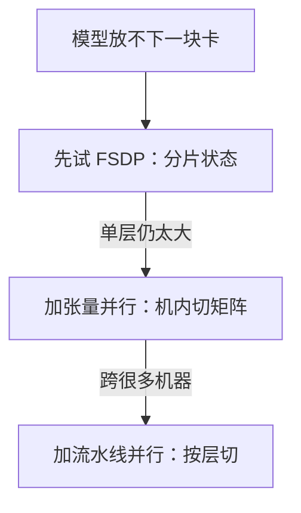

## Q
模型太大放不进一块 GPU 时，张量并行、流水线并行和分片数据并行（ZeRO / FSDP）各怎么切？各自的代价是什么？

## A
**分片数据并行**（ZeRO，PyTorch 里叫 FSDP）：仍是数据并行，但每块卡只存一部分状态。
- 阶段 1 分片优化器状态，阶段 2 再分片梯度，阶段 3 连参数也分片。
- 7B 模型的 112 GB 状态分到 8 块卡，每块约 14 GB。
- 计算某一层前，临时从其他卡收集这一层的完整参数，用完即丢。
- 代价：通信量比普通数据并行多约一半；实现最简单，模型代码几乎不用改，是中等规模模型的首选。

**张量并行**（tensor parallelism）：把一层内部的大矩阵乘法切开。例如一个 4096 × 16384 的权重矩阵按列切成 4 份，4 块卡各算四分之一，再合并结果。
- 每一层都要在卡之间交换中间结果，通信非常频繁，所以通常只在一台机器内部、用高速互联（NVLink）的 4–8 块卡之间做。
- 推理服务也常用它，把一个放不下单卡的模型分到几张卡上。

**流水线并行**（pipeline parallelism）：按层切。80 层分给 4 块卡，每块 20 层，数据像流水线一样依次经过。
- 问题是"气泡"（bubble）：第 1 块卡算完第一批时，后面的卡在等。把一个批切成 m 个微批（micro-batch）轮流送入可以减小气泡，空闲比例约为 (p − 1) ÷ (m + p − 1)，p 是流水线段数。
- 例：p = 4、m = 8：3 ÷ 11 ≈ **27%** 时间空闲；m = 32 时降到约 9%。
- 通信只在相邻段之间，适合跨机器。

**大模型的典型组合**（三维并行）：机器内张量并行、机器间流水线并行、最外层数据并行（或 FSDP）。例如 512 块卡 = 8（张量）× 8（流水线）× 8（数据）。

**选择原则**：先试 FSDP；单层太大或单机放不下再加张量并行；跨很多机器时加流水线并行。
