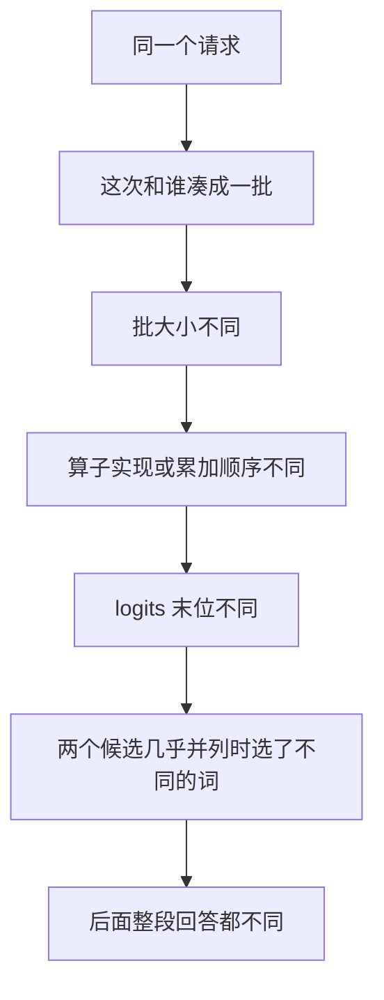

## Q
同一个大模型、同一个提示词、温度设为 0，推理服务两次返回的回答却不一样。为什么？发布验证时怎样做才能可复现？

## A
**温度为 0**：生成每个 token（模型处理文字的最小单位，约一个词或半个词）时，总是选概率最高的那个（贪心解码），理论上应该确定。不一样的原因在**数值**上：

- **凑批**（batching）：推理服务把同时到达的多个请求合在一起算。批大小变了，底层矩阵乘法可能选用不同的实现、切块方式和累加顺序。
- **浮点加法顺序**：顺序不同，结果在最后几位不同。logits（模型对词表里每个词打的原始分数）差了 0.0001，平时没影响；但两个词几乎并列时，最高分就换了人。
- **一步不同、后面全不同**：生成是一个词接一个词的，第 30 个词换了，后面的上下文就全变了。
- **其他来源**：多卡并行时的通信归约顺序、前缀缓存命中与否走了不同的计算路径、不同 GPU 型号或引擎版本。

**发布验证时怎么做：**
- **固定条件**：同硬件、同卡数、同引擎版本；批大小固定为 1 或固定的并发；关掉前缀缓存这类会改变计算路径的功能，或分别测试开和关。
- **比较数值而不是文字**：对固定输入，比较新旧版本在每个位置上的 logprob（模型给实际那个词的对数概率），差值在容差内就算一致；用文字逐字比较会被并列词的翻转大量误报。
- **比较分布而不是单次**：用任务准确率等统计指标判断有没有回归，单条回答不同不算失败。
- **记录种子**：温度大于 0 时，请求里固定 `seed`；但要知道，凑批不同时同一种子也不保证完全相同。
