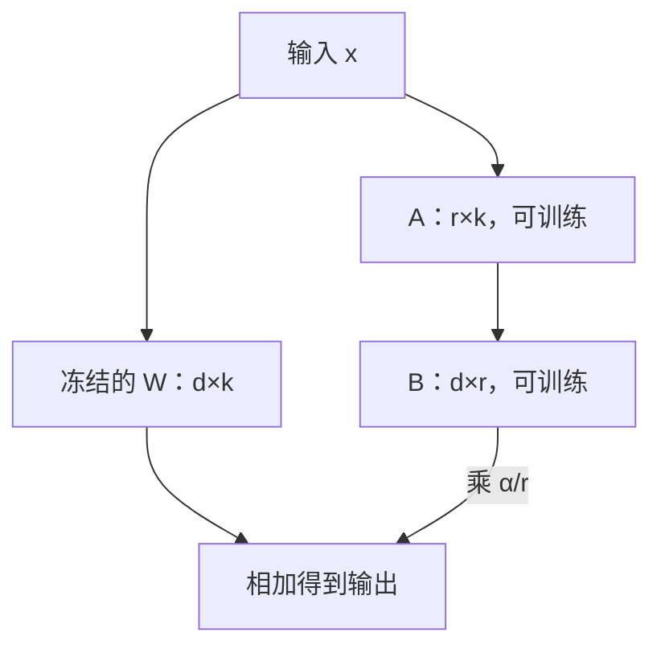

## Q
LoRA 是怎么做到"只训练很少的参数"的？手算一个权重矩阵上 LoRA 的参数量，并写出用 PEFT 库加 LoRA 的代码。

## A
**全量微调**：模型所有参数都参与训练。7B 模型就是 70 亿个数都在改，显存和存储代价都很大。

**LoRA**（low-rank adaptation，低秩适配）：冻结原有权重 W 不动，在旁边加两个小矩阵 B 和 A，只训练它们：

W' = W + (α ÷ r) × B × A

- W 是 d × k 的矩阵；A 是 r × k，B 是 d × r，r（秩，rank）远小于 d 和 k，常取 8 或 16。
- B 初始化为全 0，所以训练开始时 W' = W，模型和原来完全一样。


- α 是缩放系数，控制增量的强度。

**手算**：注意力层里一个 4096 × 4096 的投影矩阵。
- 原矩阵参数：4096 × 4096 = **16,777,216**。
- r = 8 时 LoRA 参数：8 × 4096 + 4096 × 8 = **65,536**，约原矩阵的 **0.39%**。
- 一个 32 层的 7B 模型，只在每层的 Q 和 V 两个投影上加：32 × 2 × 65,536 ≈ **420 万**个可训练参数，约总参数的 0.06%。

```python
from peft import LoraConfig, get_peft_model
cfg = LoraConfig(r=8, lora_alpha=16, lora_dropout=0.05,
                 target_modules=["q_proj", "v_proj"], task_type="CAUSAL_LM")
model = get_peft_model(base_model, cfg)
model.print_trainable_parameters()   # 打印可训练参数占比
```
（PEFT 的默认值是 `r=8`、`lora_alpha=8`、`lora_dropout=0.0`，显式写出来更清楚。）

**好处：**
- 显存：不用为冻结的 70 亿参数存梯度和优化器状态。
- 存储与切换：一个适配器（adapter）只有几 MB 到几百 MB，一个基座模型可以挂很多个，按请求切换。
- 上线：可以把 B × A 合并回 W（`merge_and_unload()`），推理时没有额外开销；也可以不合并，让服务动态加载多个适配器。

**代价**：容量有限，对需要大量新知识或大幅改变能力的任务，效果可能不如全量微调。
