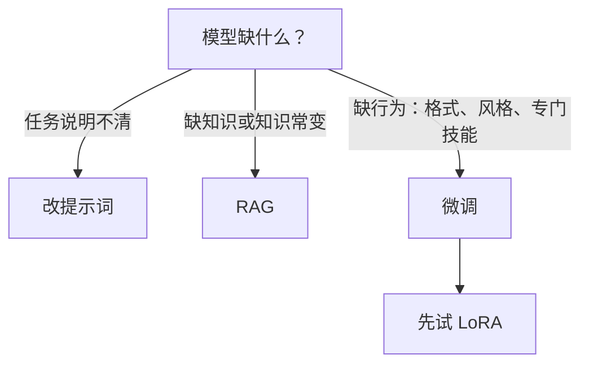

## Q
想让一个现成的大语言模型在自己的业务上表现更好，有写提示词、检索增强（RAG）和微调三种办法。它们各解决什么问题？怎么选？

## A
**三种办法：**
- **写提示词**（prompt engineering）：不改模型，只改输入。把任务说明、格式要求、几个示范例子（少样本，few-shot）写进给模型的文字里。几分钟就能试，零训练成本。
- **检索增强生成**（RAG，retrieval-augmented generation）：不改模型。用户提问时，先从自己的文档库里检索出相关段落，拼进提示词，再让模型回答。
- **微调**（fine-tuning）：在已有模型上，用自己的样本继续训练，改变模型的参数。

**各自擅长：**
- **提示词**：任务描述清楚就能做好的事。永远第一步，也是后两者的基线。
- **RAG**：模型**不知道的事实**，尤其是经常变化的（产品文档、价格、内部知识）。更新知识只需更新文档库；还能给出引用、方便核实。微调很难可靠地"灌进"大量事实，且知识一变就要重训。
- **微调**：模型**会但做得不稳定的行为**：固定的输出格式、特定语气、领域内的分类或抽取、把长提示词"内化"以省 token；或者用小模型通过微调达到大模型在单一任务上的水平，降低推理成本。

**成本对比（量级）**：提示词几乎为零；RAG 要建检索系统，每次请求多几百到几千个 token 的输入；微调要准备数千条高质量样本、训练资源，以及每次换基座模型都要重新微调和评测。

**常见答案**：先提示词，缺知识上 RAG，格式或风格仍不稳定再微调；三者可以叠加。
