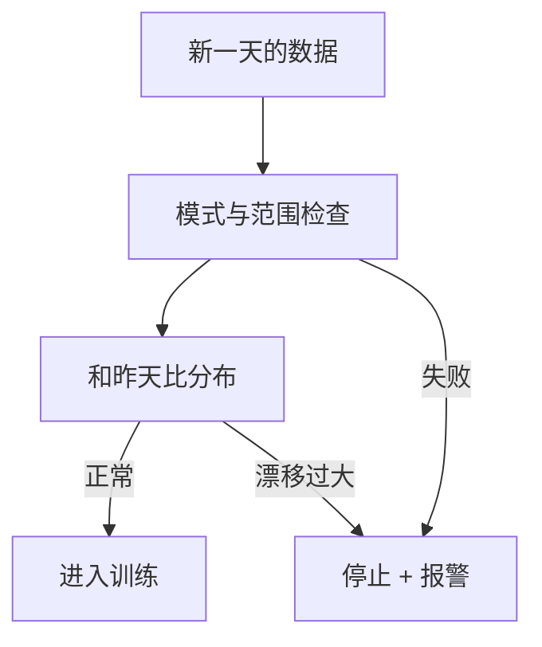

## Q
上游数据出错时，训练流水线可能"成功地"训练出一个坏模型并上线。举一个例子，并说明数据校验步骤要检查什么。

## A
**例子**：上游日志服务一次发布后，"视频时长"字段 30% 变成了空值，空值在特征转换里被填成 0。流水线照常跑完：训练没有报错，测试集也来自同一批坏数据，指标只下降了 0.3%，低于评估的报警线。新模型自动注册上线，它学到"时长为 0 的视频很受欢迎"，开始大量推荐异常视频。所有组件都"成功"了。

**数据校验要检查的：**
- **模式**（schema）：字段是否齐全、类型是否正确、枚举值是否在已知集合里。
- **完整性**：空值比例、行数和前 7 天同期相比的变化，例如行数波动超过 ±20% 或某字段空值比例从 1% 升到 5% 就停。
- **取值范围**：年龄在 0–120，时长大于 0，概率在 0–1。
- **分布变化**：每个特征和前一天的分布距离，例如用 PSI（群体稳定性指数，衡量两个分布差多少；常用 0.1 为轻微、0.2 以上为明显变化）或类别特征的 L∞ 距离（各类别占比差的最大值）。
- **训练与服务一致**：同一批实体的离线特征和线上记录的特征抽样比对。
- **标签分布**：正例比例突然从 2% 变成 6%，多半是日志 bug 而不是用户变了。

**工具**：TensorFlow Data Validation 从数据自动推出模式并对比统计量；Great Expectations 用声明式的"期望"写检查规则。

**设计原则**：数据校验失败应**阻断**流水线，而不是只打日志；阈值宁可先严后松，因为放过一次坏数据的代价是一个坏模型上线。
