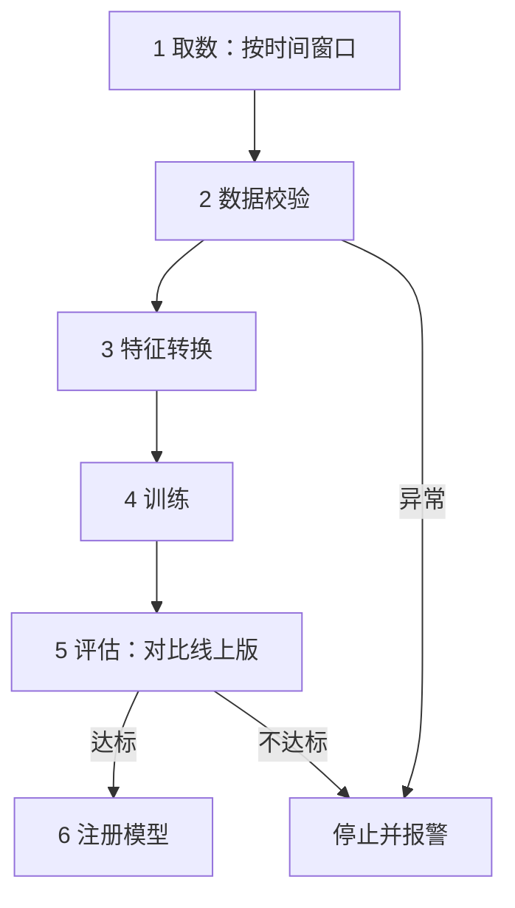

## Q
一条训练流水线（training pipeline）从原始数据到可上线的模型，经过哪几步？每一步的输入、输出和产物是什么？

## A
**训练**：用历史数据反复调整模型（带大量可调数字的函数）里的参数，让它的预测接近标签（正确答案）。训练流水线把这件事做成可重复、可自动运行的一串步骤。

1. **取数**：输入是日志表和时间窗口（例如过去 28 天）；输出是原始样本快照，记录数据版本（表名 + 分区 + 行数）。
2. **数据校验**：输入是样本快照；检查字段类型、空值比例、取值范围、和前一天的分布差异。输出是校验报告；不通过就停。
3. **特征转换**：归一化、分桶、词表映射。输出是训练用的特征文件，以及**转换参数**（均值、桶边界、词表），这些要和模型一起发布，线上用同一份。
4. **训练**：输入是特征文件和配置（超参数：学习率、批大小等由人设定的数）；输出是模型文件和训练曲线。中途定期存检查点（checkpoint，训练状态的快照，失败后可从这里继续）。
5. **评估**：在固定测试集上算指标，并和当前线上模型比较，整体和各切片（新用户、各国家）都不能变差。输出是评估报告。
6. **注册**：把模型文件、转换参数、数据版本、代码版本、配置、评估报告一起写进模型注册表（model registry，管理模型版本和元数据的服务），状态为"候选"，等发布流程接手。

**关键原则**：每一步只依赖上一步的产物，产物都带版本；任何一步失败可以单独重跑；整条流水线由代码定义，和应用代码一样走评审。
