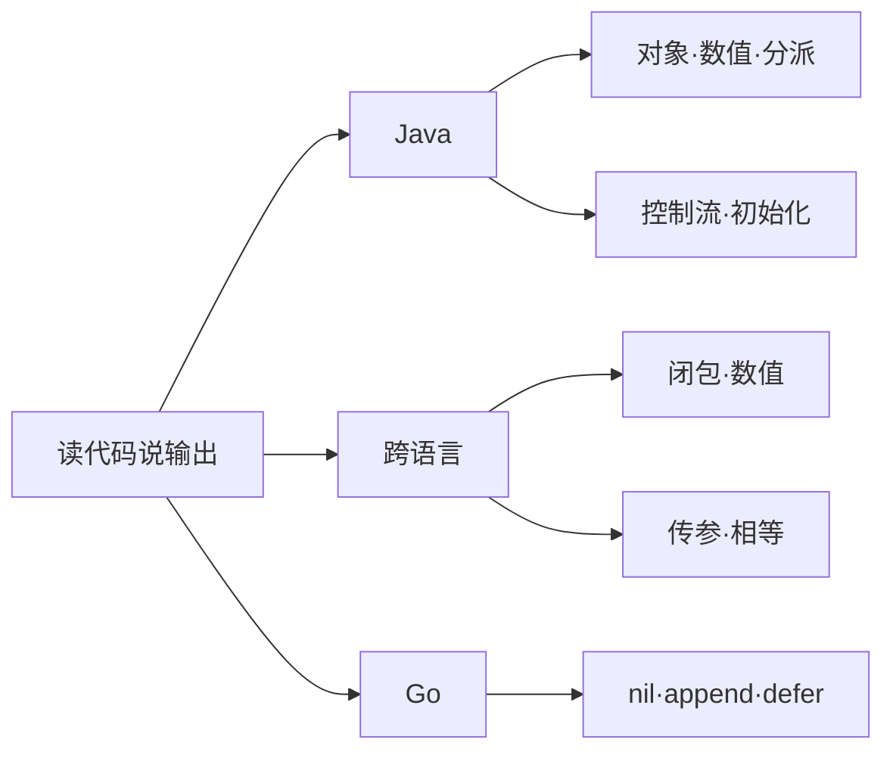

## Q
**读代码说输出：整张图**｜地图

读一段短代码、说出它打印什么，最该先想清楚的几件事是什么？

## A
**一句话。** 这些输出题考的不是语法，而是「什么时候决定」和「共享的是什么」：名字在编译期还是运行期绑定，捕获和传递的是变量、引用还是拷贝。

**关键直觉。**
- 编译期决定的事，看静态类型和常量：Java 的重载、字段、`static`、字符串常量折叠、常量内联，都在编译期定死，运行期的真实对象改变不了。
- 运行期决定的事，看对象本身：只有被重写的实例方法按实际类型分派；`==`、`equals`、哈希则取决于比较的是身份还是内容。
- 变量和值要分开：闭包捕获的是变量（Python、JavaScript `var`、Go 1.21 共享一个，Java 只允许不变的），传参传的是引用的拷贝，Go 切片共享底层数组，Rust 则把所有权移走。
- 边界处语言各自选了取舍：整数溢出回绕、panic 还是未定义，负数取整向零还是向下，`==` 是否转换类型；记住每种语言选了哪边，比背输出更有用。
