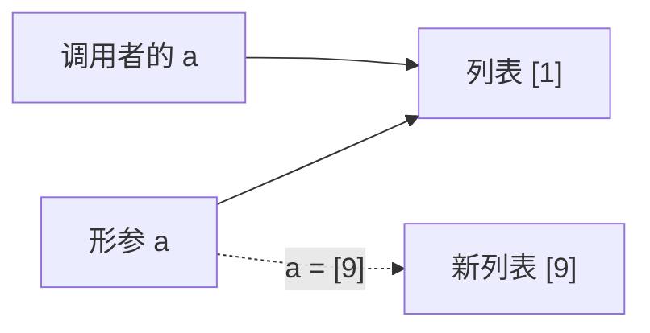

## Q
**改对象与改变量**｜读代码说输出

**Python**
```python
def f(a):
    a.append(1)
    a = [9]
a = []
f(a)
print(a)
```
**Java**
```java
public class Main {
    static void f(List<Integer> a) { a.add(1); a = new ArrayList<>(List.of(9)); }
    public static void main(String[] x) {
        List<Integer> a = new ArrayList<>();
        f(a);
        System.out.println(a);
    }
}
```
**C++（参数 vector<int> a）**
```cpp
void f(vector<int> a) { a.push_back(1); a = {9}; }
int main() {
    vector<int> a;
    f(a);
    cout << a.size() << endl;
}
```
**C++（参数 vector<int>& a）**
```cpp
void f(vector<int>& a) { a.push_back(1); a = {9}; }
int main() {
    vector<int> a;
    f(a);
    cout << a[0] << " " << a.size() << endl;
}
```

输出什么？

## A
**输出。**
**Python**
```
[1]
```
**Java**
```
[1]
```
**C++（vector<int> a）**
```
0
```
**C++（vector<int>& a）**
```
9 1
```

**为什么。**
- Python 和 Java 传的是引用的拷贝（引用按值传递）：形参 `a` 与实参指向同一个列表，`append` / `add` 通过它修改了共享对象，调用者看得到。
- `a = [9]` 只是让形参改指向新对象，调用者的变量没动，所以结果是 [1]，不是 [9]。
- C++ 的 `vector<int> a` 参数是整个容器的拷贝，函数里的修改全部丢失，size 为 0。改成引用 `vector<int>& a`，形参就是实参的别名，先 `push_back(1)` 再 `a = {9}` 直接改了调用者的变量，得 9 和 size 1。



**语言为什么这样设计。**
- Python、Java、Go 都是「传共享引用」（call by sharing，Liskov 在 CLU 语言里提出的叫法）：不拷贝大对象，又不让被调用者重新绑定调用者的变量。Java 因此写不出 `swap(a, b)`。
- C++ 把选择权交给你：值、引用、指针，代价是必须读签名才知道会不会改到调用者。

**怎么写才对。**
```python
def f(a):
    a[:] = [9]          # 原地替换内容，调用者可见
```
```java
a.clear(); a.addAll(List.of(9));
```

**面试里一句话。**
Python and Java pass object references by value: the callee can mutate the object but cannot rebind the caller's variable.
