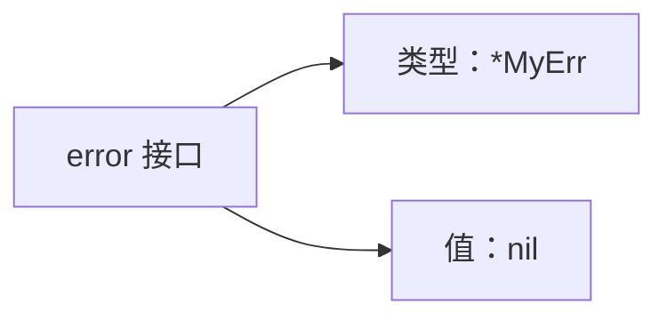

## Q
**nil 接口不等于 nil**｜读代码说输出

```go
type MyErr struct{}
func (*MyErr) Error() string { return "e" }
func f() error {
	var p *MyErr
	return p
}
func main() {
	err := f()
	var p *MyErr
	fmt.Println(err == nil, p == nil)
	fmt.Printf("%T\n", err)
}
```

输出什么？

## A
**输出。**
```
false true
*main.MyErr
```

**为什么。**
- 接口值（interface value）内部是一对：动态类型和动态值。`return p` 把类型为 `*MyErr`、值为 nil 的指针装进 `error`，得到 `(*MyErr, nil)`。
- 接口只有在类型和值都是 nil 时才等于 nil；这里类型非空，所以 `err == nil` 是 false。`p == nil` 比的是指针本身，true。
- 调用者按惯例写 `if err != nil` 会误以为出错了；`%T` 打印出动态类型 `*main.MyErr`。



**语言为什么这样设计。**
- Go 的接口要能装任何具体类型，所以必须存类型信息；nil 指针又是合法的接收者，方法照样能调用，因此 `(T, nil)` 是一个有效的接口值，规范不能把它当成 nil。
- Java 的引用只有一种 null；Rust 没有 null，用 `Option`。Go 的设计让 nil 接收者能正常工作，代价就是这个坑。

**怎么写才对。**
```go
func f() error {
    if bad { return &MyErr{} }
    return nil               // 没有错误就直接返回 nil
}
```

**面试里一句话。**
A Go interface holding a nil pointer is not nil, because the interface stores the type as well as the value.
