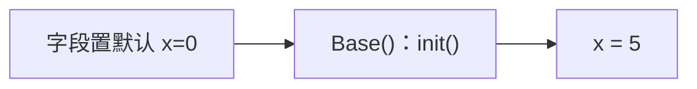

## Q
**构造器里调可重写方法**｜读代码说输出

```java
class Base {
    Base() { init(); }
    void init() { System.out.println("Base.init"); }
}
class Sub extends Base {
    int x = 5;
    String s = "hi";
    void init() { System.out.println("Sub.init x=" + x + " s=" + s); }
}
public class Main { public static void main(String[] a) {
    Sub sub = new Sub();
    System.out.println(sub.x);
} }
```

输出什么？

## A
**输出。**
```
Sub.init x=0 s=null
5
```

**为什么。**
- `new Sub()` 先分配对象，把所有字段置为默认值（0、null），再运行构造器链。
- `Sub` 的构造器第一步是调用 `Base()`，此时 `Sub` 自己的字段初始化（`x = 5`）还没执行。
- `Base()` 里的 `init()` 是虚调用，分派到 `Sub.init`，读到的是默认值 0 和 null；`Base()` 返回后才执行 `x = 5`，所以最后 `sub.x` 是 5。



**语言为什么这样设计。**
- JLS 12.5 规定顺序：默认值，父类构造器，子类字段初始化，子类构造器体；构造期间虚调用仍按真实类型分派，所以子类方法会看到半成品对象。
- C++ 选了相反的安全做法：构造期间对象的动态类型是正在构造的那一层，`Base()` 里调 virtual 只会到 `Base` 的版本。Java 选了「始终多态」，代价就是这个坑。

**怎么写才对。**
```java
Base() { init(); }   // 避免：init 可被重写
private void init() {…}   // 构造器里只调 private/final/static 方法
```

**面试里一句话。**
A constructor that calls an overridable method runs the subclass override before the subclass fields are initialized.
