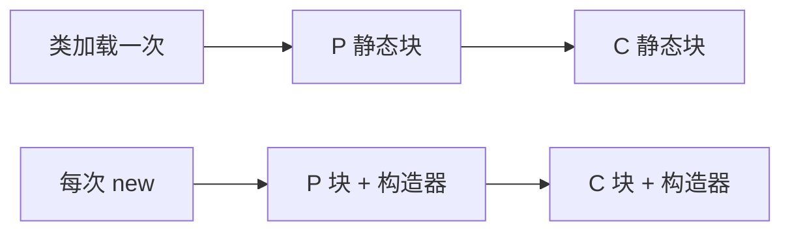

## Q
**父类与子类的初始化**｜读代码说输出

```java
class P {
    static { System.out.println("P static"); }
    { System.out.println("P block"); }
    P() { System.out.println("P ctor"); }
}
class C extends P {
    static { System.out.println("C static"); }
    { System.out.println("C block"); }
    C() { System.out.println("C ctor"); }
}
public class Main { public static void main(String[] x) {
    new C();
    System.out.println("--");
    new C();
} }
```

输出什么？

## A
**输出。**
```
P static
C static
P block
P ctor
C block
C ctor
--
P block
P ctor
C block
C ctor
```

**为什么。**
- 类初始化发生在第一次使用之前：先父类后子类，各自运行静态块，所以先 `P static` 再 `C static`，而且每个类只运行一次。
- 每次 `new C()`：先运行父类的实例块和构造器，再运行子类的实例块和构造器，实例块按源码顺序在构造器体之前。
- 第二次 `new C()` 没有静态行，因为类已经初始化过。



**语言为什么这样设计。**
- JLS 12.4、12.5 规定父类先于子类，因为子类的初始化可能依赖父类的状态；静态初始化只做一次、首次使用时才做（懒加载），实例初始化每次 new 都做。
- C++ 也是父类先构造、子类后构造，销毁时相反；Python 没有隐式的父类构造，`__init__` 里要自己写 `super().__init__()`，忘了就不会执行。

**怎么写才对。**
```java
// 静态块只放简单常量；复杂初始化用工厂方法或 holder 类
static Config create() { … }
```

**面试里一句话。**
Superclass static initializers run first, then the subclass's; each new runs parent instance init and constructor before the child's.
