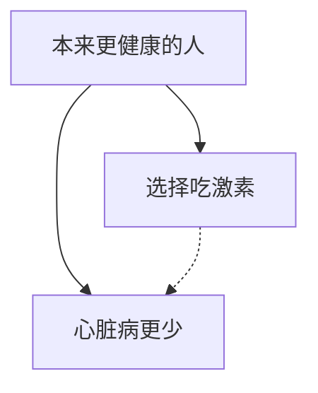

## Q
有研究追踪了几万人：每天喝咖啡的人更长寿，爱锻炼的人更少抑郁，用某个习惯 App 的人更自律。这些相关背后，要排除哪几种可能，才敢说「做了 A 就会得 B」？哪种研究设计能回答？

## A
**相关不等于因果（correlation vs causation）：两件事一起出现，可能是 A 导致 B，也可能是 B 导致 A、有个共同原因 C，或者进入样本的方式有偏。只有随机分组的实验和自然实验能回答因果。**

**故事。** 几十年里，观察研究都说绝经后吃激素对心脏有好处。其中的护士健康研究追踪了 70,533 名绝经后女性，目前在吃激素的人发生重大冠心病事件的风险是从没吃的人的 0.61 倍。2002 年，Women's Health Initiative 做了随机实验：16,608 名女性随机分到激素（雌激素加孕激素）或安慰剂，平均 5.2 年后因风险超过益处提前叫停，冠心病风险比是 1.29，不降反升。常见的解释是：选择吃激素的人本来就更健康。

- **证据 · 强：** 这是观察研究与随机实验方向相反的经典例子。观察数据可以提出假设，不能证明因果。
- **动手：** 下次读到「A 的人更 B」的时候，写下三个问题：会不会是 B 导致 A？有没有一个让人既选 A 又得 B 的原因？有没有做过随机分组的实验？三个问题答不上，就当它只是线索，不为它改变生活。
