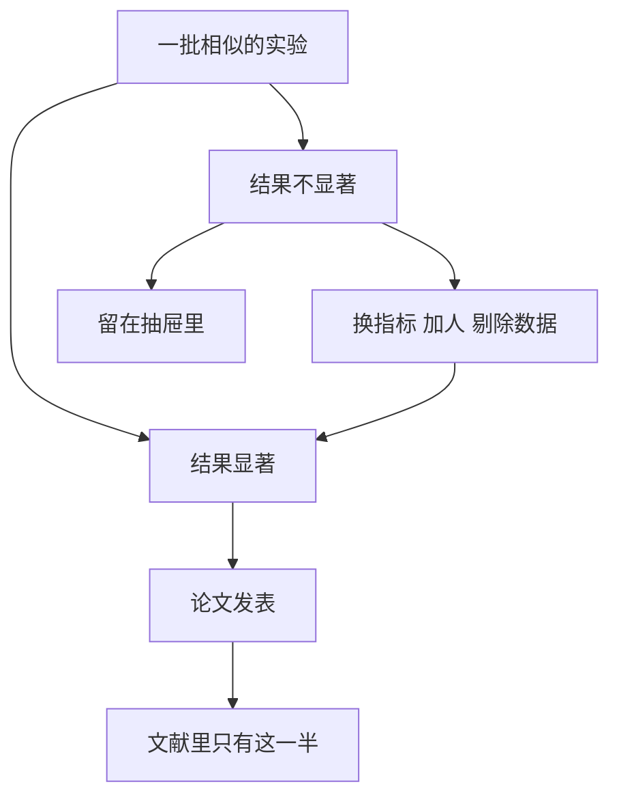

## Q
你搜到十篇论文，九篇都说某种补剂或某种学习方法有效。你该不该因此相信它有效？这九篇的作者没有造假，问题还可能出在哪？

## A
**发表偏倚与 p 值操纵（publication bias, p-hacking）：有效果的研究容易发表，没效果的留在抽屉里；研究者又有许多分析上的自由，所以文献整体会高估效果。**

**故事。** 2011 年，Simmons、Nelson 和 Simonsohn 在宾大找了 20 名本科生，让一半人听披头士的《When I'm Sixty-Four》，另一半听一首纯音乐《Kalimba》，再问生日。控制父亲年龄后，听披头士的人「年轻了 1.5 岁」，p = .040，达到了发表标准。这当然是假的：他们要演示的是，边看数据边决定加不加人、算哪个指标、剔不剔数据，这些常见的做法叠在一起，会让假结论在 61% 的模拟里达到显著。

- **证据 · 强：** 2020 年 Kvarven 等人拿 15 对「元分析 vs 预注册的多实验室重做」比较，元分析的效应量平均约为重做的 3 倍。后来有人重新分析，认为差距里一部分来自研究之间本来就不同，不全是发表偏倚。
- **动手：** 下次想靠一篇文献综述做决定（吃什么、练什么、用什么学习法）的时候，先找有没有预注册的大样本实验。只有一堆小样本研究都说有效，就把效果预期砍掉一大半再用。
