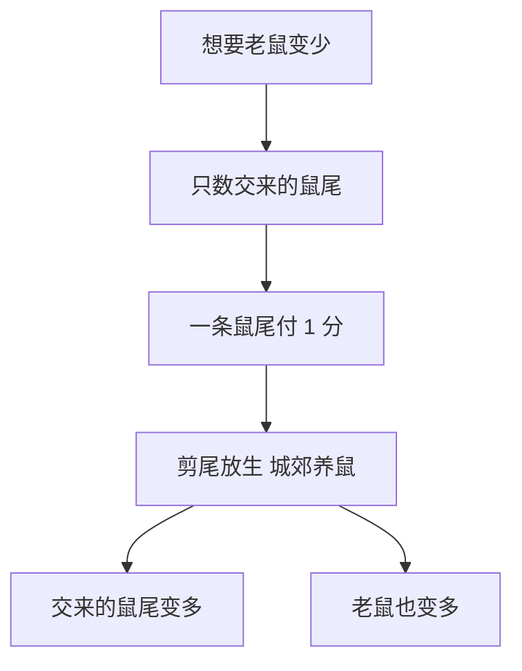

## Q
你们组的 OKR 考核「每季度关掉的工单数」。两个季度后这个数翻了一倍，用户投诉却一点没少。中间发生了什么？

## A
**古德哈特定律（Goodhart's law）：一个数字一旦被拿来考核，人就会去优化这个数字本身，它也就不再反映原来想衡量的东西。**

**故事。** 1902 年 4 月，法属印度支那的河内防鼠疫，殖民政府雇人下水道捕鼠，按只付钱。嫌进度慢，又对全城悬赏：交一条老鼠尾巴给 1 分钱。不久官员在街上看到没尾巴的活老鼠：捕鼠的人剪了尾巴就放走，让它们接着生。卫生检查员还在城郊发现专门养鼠割尾的农场。悬赏取消时，鼠患比原来还重。历史学家 Vann 2003 年据法国殖民档案写出了这段历史。

- **证据 · 强：** 经济学家 Goodhart 1975 年讲英国货币政策时提出这一点；「指标一旦成了目标，就不再是好指标」这句流行说法出自人类学家 Strathern 1997 年。企业里也一样：富国银行（Wells Fargo）员工为完成销售指标私开账户，2016 年被罚 1.85 亿美元，约 5,300 人被开除。
- **动手：** 下次你定或被考核一个指标（关单数、代码行数、测试覆盖率），给它配一个对手指标：关单数配重开率，覆盖率配线上缺陷数。每季度随手抽 5 个样本人工看，确认数字背后是你真正想要的东西。
