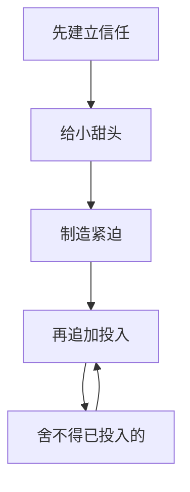

## Q
网上认识了几个月的人，说有个稳赚的投资，先让你小额试一笔，真的提现了。你为什么该在这时停下来？

## A
**骗局的结构（anatomy of a scam）：长线骗局靠一串步骤，建立信任、给小甜头、制造紧迫、让你舍不得已经投进去的。**

**故事。** 2009 年，英国公平贸易局（OFT）请埃克塞特大学的 Lea、Fischer 和 Evans 查「人为什么会被骗」。他们采访受害者、分析骗子寄出的材料，做了问卷和一个行为实验，写成 260 页的报告。结论不是受害者蠢：他们常常在奖券、投资这类话题上有比别人更多的知识，也花了更多力气研究那份材料。骗子的手法是：冒充官方和可信的机构，先要一小步配合，再叫你为已经付出的继续付；大奖看得见，先付的那点钱看不见。

- **证据 · 中：** 这份报告的结论来自访谈和问卷。FTC 的投诉数据显示 2022 年美国近 7 万人报告了交友类骗局，总损失 13 亿美元，损失中位数 4,400 美元。
- **动手：** 下次有人在线上让你「先投一点试试」，在第二笔转出之前，把整件事原样讲给一个不认识对方的朋友听，让他回答：如果这是一个陌生人第一天就提的，你会投吗？不会，就停；已经投进去的那笔不算理由。
