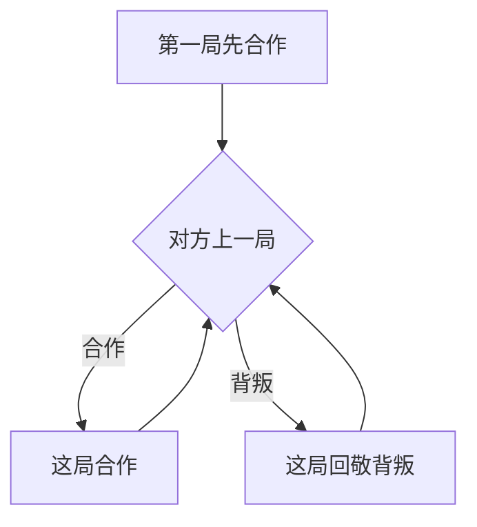

## Q
组里一个同事上次故意拖着不审你的 PR。你们还要一起干好几年。他下一个 PR 来了，你怎么对他？

## A
**以牙还牙（tit for tat）：和同一个人反复打交道时，先合作、被坑就回敬一次、对方改了马上原谅，是最稳的打法。**

**故事。** 1980 年，密歇根大学的 Axelrod 请各路学者交电脑程序，两两对打重复的囚徒困境（每局各选合作或背叛，背叛单局多拿，都背叛最亏），比总分。第一轮 14 个程序，赢的是最短的那个：Rapoport 交的「以牙还牙」，第一步合作，之后照抄对方上一步。Axelrod 公布结果再办第二轮，60 多个程序都知道它是冠军，它又赢了。它跟谁单挑都不可能比对方得分高，它赢在让对手愿意一直合作。

- **证据 · 强：** 2025 年一组人重跑第二轮的原始程序，冠军仍是它。但会有误操作时，Nowak 和 Sigmund 1993 年在 Nature 上发现「赢了就保持、输了就换」（win-stay lose-shift）能纠正误会，在模拟里胜过它。Dal Bó 和 Fréchette 2011 年的实验里，真人只在再见面的概率高、合作收益大时才稳定合作。
- **动手：** 下次有人坑你一次，回敬一次，比如他的 PR 照常排队、不再插队帮他；他一恢复正常，你下一次就恢复。对方像是无心之失，先多给一次机会再回敬。
