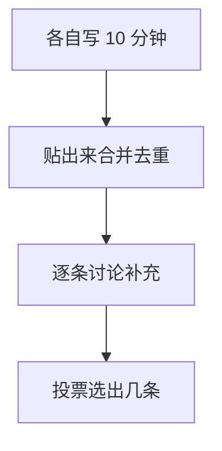

## Q
产品要想新点子，你拉 5 个人进会议室，白板前轮流喊。同样这 5 个人，各自安静写 10 分钟再汇总，点子会更多还是更少？

## A
**头脑风暴不如各自先想（brainstorming）：同样几个人，各自写完再汇总，点子比坐在一起说更多、更好。**

**故事。** 「头脑风暴」是广告公司高管 Alex Osborn 在 1953 年的《Applied Imagination》等书里推广的：别批评，多多益善，大家一起喊，点子更多更好。他没有拿出对照数据。1958 年，Taylor、Berry、Block 在 Yale 做了对照：4 人一组真正坐在一起头脑风暴，对比同样人数的人单独做、事后把各人的点子合在一起算（叫「名义小组」）。三道题，按数量、独创性和质量打分。名义小组显著胜过真正的小组。

- **证据 · 强：** Diehl 和 Stroebe 1987 年的实验指出主因是「产出阻塞」：一次只有一个人能讲，别人要么等着，要么忘了自己的点子。Mullen、Johnson、Salas 1991 年的元分析：现场小组的数量和质量都不如名义小组，人越多差距越大。
- **动手：** 下次要点子的会，会前或开头先给每人 10 分钟，各自在便签或文档里写，再合并去重，才开始讨论和投票。
