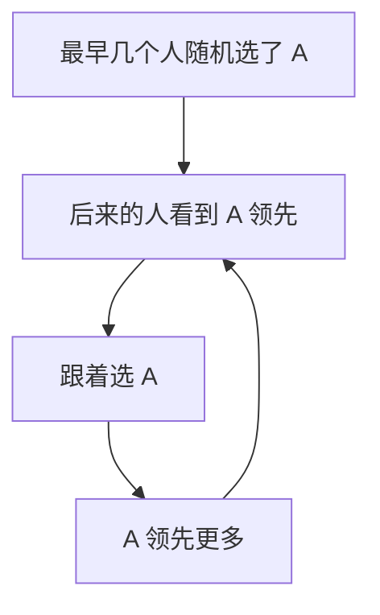

## Q
两个功能差不多的开源库，一个 star 多得多，你选了它。同一首歌放进几个平行的「世界」里，会不会有的世界它排第一，有的世界它排四十名开外？

## A
**羊群效应与信息瀑布（herd behavior, information cascade）：后来的人看前面人的选择来判断，早期一点随机的领先会滚成压倒性的流行。**

**故事。** 2006 年，Salganik、Dodds、Watts 做了一个网上音乐站：14,341 个青少年访客，48 首没人听过的歌，可以试听、下载。一部分人看不到别人的选择；另一部分人被随机分进 8 个互不相通的「世界」，每个世界里歌名旁边写着下载次数。结果：有下载数的世界里，热门更热，各世界的榜单却互不一致。一首独立评分排第 26 的歌，在一个世界是第 1 名，在另一个世界排到第 40。质量最好的歌很少垫底，最差的很少登顶，中间什么都可能发生。

- **证据 · 强：** 2013 年 Muchnik、Aral、Taylor 在一个新闻聚合网站随机给新评论加一个赞：之后获得好评的可能性高 32%，最终评分平均高 25%。只对正面的有效，被随机踩的评论会被用户纠正回来。
- **动手：** 下次靠 star 数、下载量、「已有 X 人购买」选东西时，先把这个数字盖住，只看文档、issue 里的真实问题、最近一次提交。选完再看数字。
