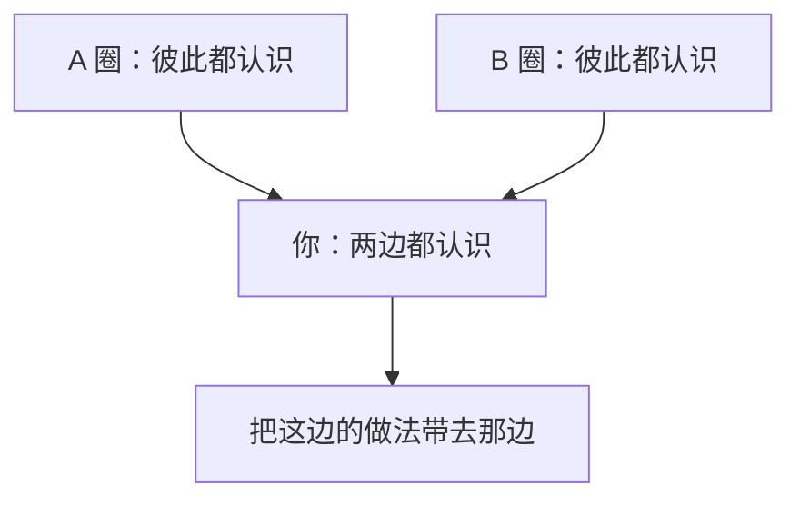

## Q
你在后端组，隔壁数据组每周在做什么你并不知道，两个组的人也很少来往。站在这两个组中间、同时认识两边的人，点子是不是更好、升得是不是更快？

## A
**结构洞（structural holes）：站在两个互不来往的圈子之间的人，更早看到两边的信息，好点子和晋升都更多。**

**故事。** 2001 年，社会学家 Burt 研究美国一家大型电子公司的供应链部门：673 位经理，领导层正好换届，想借一次网络调查摸清谁和谁在讨论什么。经理们被要求写下一条改进供应链运营的点子，共收到 455 条，由两位高层给每条打 1 到 5 分。结果：有跨组联系的经理，点子被评得更有价值；薪酬、绩效评价、晋升也都偏向这些「桥」上的人。Burt 控制了职级等变量，这个关联仍在。

- **证据 · 强：** Burt 在同一篇文章里梳理的其他研究方向一致。但这些都是相关，不是随机实验，他自己的数据也只来自一家公司。「桥」的人不一定更聪明，只是更早听到两边不同的做法。
- **动手：** 这周约一个别的组的人喝咖啡 30 分钟，问两个问题：「你们最近最头疼的事是什么」「你们怎么解决 X 的」。回来把一个对方的做法写成一页纸，带到你自己的组里讲。
