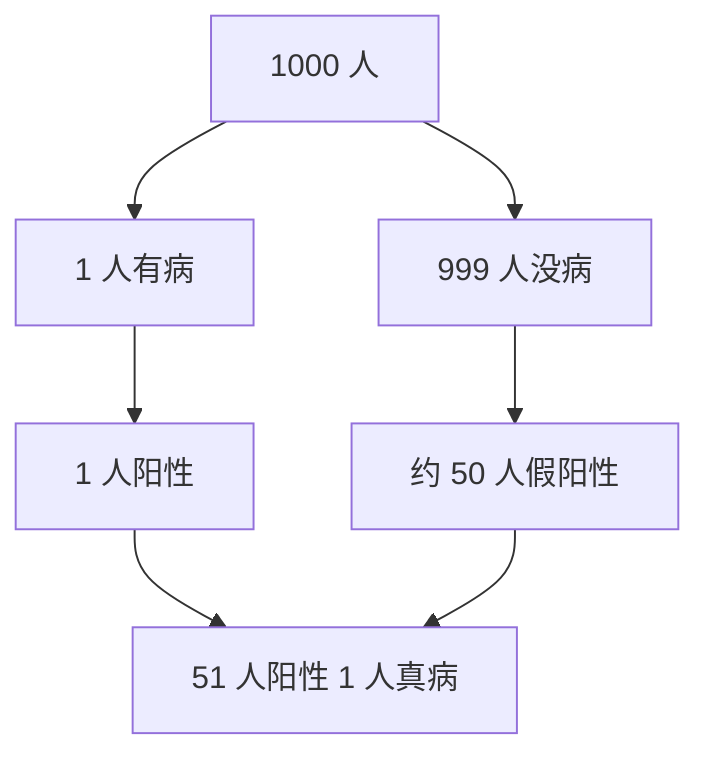

## Q
一种病，1000 人里有 1 个人得。检测的假阳性率是 5%（没病的人有 5% 会被测成阳性）。你体检测出阳性，实际得病的概率是多少？医生会不会比你算得更准？

## A
**基础比率忽略（base-rate neglect）：判断概率时只看证据「像不像」，忘了这类事本来有多常见。上面问题的答案约 2%，不是 95%。**

**故事。** 1978 年，Casscells 等人在哈佛医学院的几家教学医院里，拦下 60 位医生、住院医和医学生，问了上面的问题（题目假设检测不会漏掉真病人）。只有 11 人（18%）答出约 2%，27 人（45%）答 95%。2014 年，Manrai 等人在波士顿重做，61 人里 14 人（23%）答对，27 人答 95%，和 36 年前几乎一样。换成「1000 个人」的数法，上图一眼就能看出：51 个阳性里只有 1 个真病，约 2%。

- **证据 · 强：** 这类错误在医生和学生里都重复出现。Kahneman 和 Tversky 1973 年的工程师和律师实验也一样：被试读一段人物描述，猜他是不是工程师，名单里工程师占 30% 还是 70% 几乎不影响答案；一段毫无信息的描述，两组都答 50%。
- **动手：** 下次拿到一个「阳性」「命中」「面试官说你像高潜」的信号的时候，先问「这种人在总体里占多少」，再用「1000 个人里有几个」的写法画一张图，算完再下结论。
