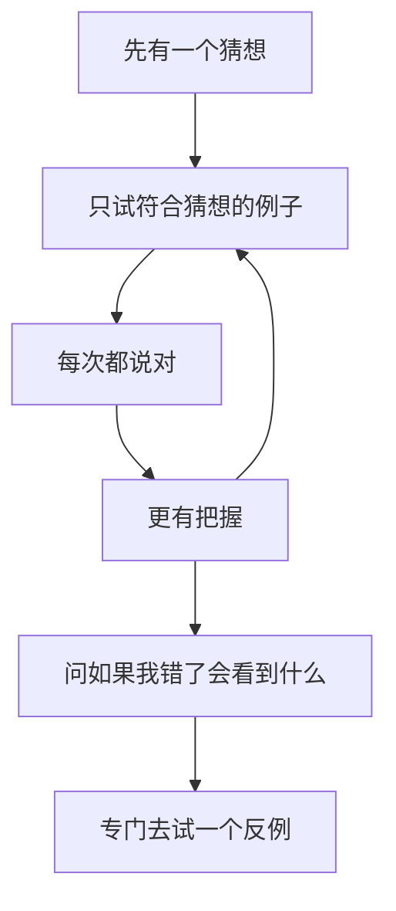

## Q
你怀疑线上 bug 是缓存引起的，于是去翻日志里和缓存有关的报错，越翻越确定。这样查，漏掉了哪一步？

## A
**确认偏误（confirmation bias）：人找的、记的、信的，多半是支持自己已有看法的证据，很少去找能推翻它的那一条。**

**故事。** 1960 年，伦敦大学学院的 Wason 给参与者看三个数「2、4、6」，说它们符合他心里的一条规则；参与者可以自己写三个数来问符不符合，有把握了再宣布答案。多数人猜「每次加 2」，接着试 8、10、12 和 20、22、24，次次「符合」，于是很有把握地宣布。真正的规则只是「从小到大」。第一次宣布就对的只有 21%：错的人很少去试 1、2、3 或 6、4、2 这种「如果我错了就会露馅」的组合。

- **证据 · 强：** 1979 年 Lord、Ross 和 Lepper 让死刑的支持者和反对者读同一对正反研究，双方都觉得支持自己的那份更扎实。「读完更极端」那一半却站不住：Guess 和 Coppock 2020 年三个大样本实验里，人看到反方证据，多是朝证据方向小幅移动，没有反弹。
- **动手：** 下次你对一个判断（bug 原因、候选人、一只股票）有了七八成把握的时候，先写一句「如果我错了，我会看到什么」，然后专门去找那个。
