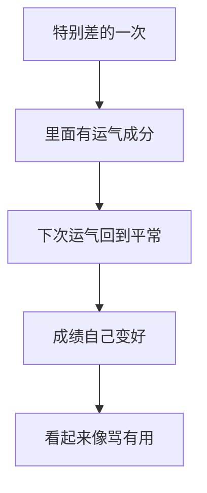

## Q
新来的同事上周 code review 里漏了一个大 bug，你狠狠说了他一顿，这周他的代码好多了。夸人的时候却常常是夸完下一次就变差。骂真的比夸管用吗？

## A
**回归均值（regression to the mean）：一次特别好或特别差的表现，有一部分是运气，下一次多半更接近平常水平，和你做了什么无关。**

**故事。** Kahneman 给以色列空军的飞行教官讲课，说奖励比惩罚更有效。一位资深教官当场反驳：学员飞出漂亮动作我夸他，下一次几乎总是更差；飞砸了我吼他，下一次通常就好了。所以夸没用，吼有用。Kahneman 后来说，那一刻他明白了：特别好的一次后面本来就多半更差，特别差的一次后面本来就多半更好，教官把这个当成了自己的功劳。

- **证据 · 强：** 这是统计上必然发生的事，只要表现里有运气成分、两次测量不是完全相关，就会出现。教官的故事是 Kahneman 在《思考，快与慢》里讲的，不是对照实验；要判断骂还是夸有没有效，需要有一组人不管表现好坏随机地被骂或被夸。
- **动手：** 下次你因为某个人一次特别差（或特别好）的表现想改变做法之前，先翻出他最近 5 次的结果，看这次是不是离他的平常水平很远；是，就先别下结论，再观察 2 到 3 次。
