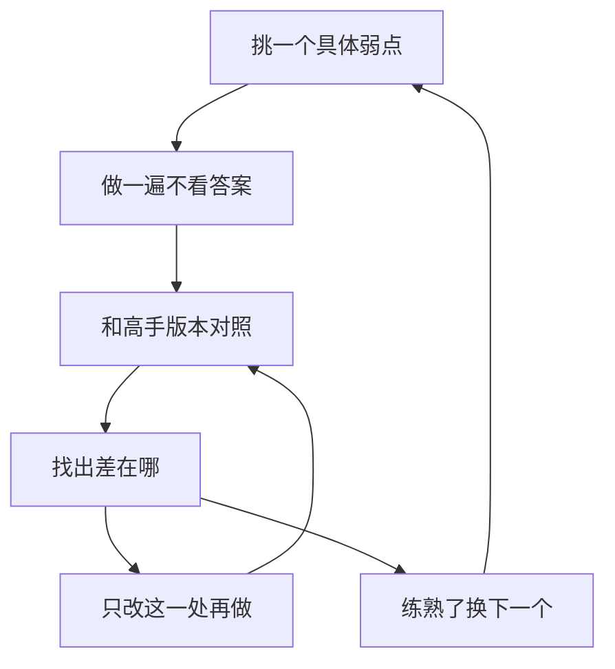

## Q
你写了五年代码，设计文档还是被评审挑出同样的毛病。年头在涨，水平好像没涨。光做得多为什么不够？该怎么练？

## A
**刻意练习（deliberate practice）：让人变强的不是做了多久，是盯住一个具体弱点、做完马上和好的标准对照、只改差的那一处，再做。**

**故事。** Franklin 在自传里写过他少年时怎么学写文章。他在波士顿的印刷所当学徒，弄到散本的一卷《旁观者》（The Spectator），觉得文笔极好。他给每篇文章的每一句记几个提示词，放几天，再不看原文，只凭提示把文章写回来，然后和原文逐句对比，找出自己的毛病改掉。他还把提示打乱，过几周再排回正确顺序，练怎么组织想法。这些都在晚上下班后、早上上工前和星期天做。

- **证据 · 中：** 2014 年 Macnamara 等人的元分析里，练习量解释的水平差异在游戏里约 26%、音乐 21%、体育 18%、教育 4%、职业里不到 1%。规则越稳定，练习越管用。
- **动手：** 下次拿到一份被夸的设计文档，先只读标题，自己写一版，再逐段对照原文，记下差得最多的一处，下一份文档只练这一处。
