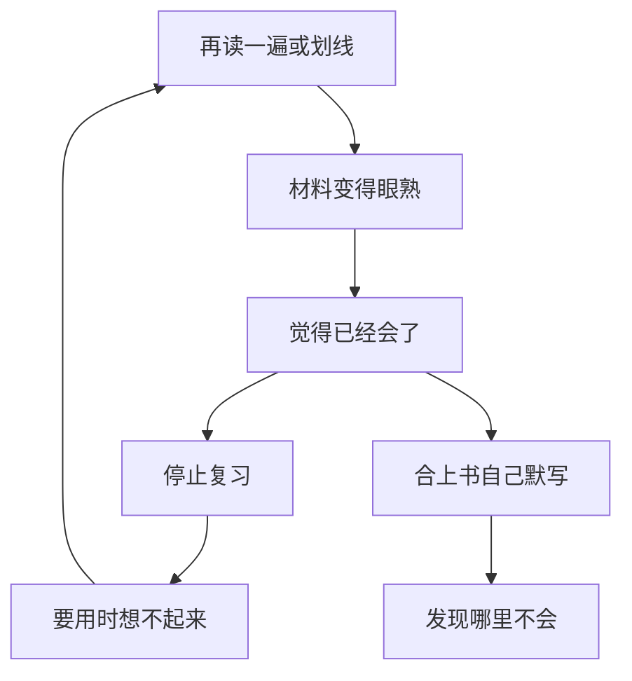

## Q
你把一份设计文档读了两遍，关键句还划了线，合上时觉得「都懂了」。第二天评审会上有人让你复述，你却卡住了。为什么「看得很顺」会让人误以为自己会了？

## A
**流畅错觉（illusion of fluency）：重读、划线、边看答案边学，会让材料变眼熟，大脑把「眼熟」当成「我会了」。**

**故事。** 2009 年，Karpicke、Butler 和 Roediger 在华盛顿大学问了 177 名本科生平时怎么复习：84% 的人写了「重读笔记或课本」，55% 把它排在第一位；只有 11% 提到自己合上书练习回忆。2005 年，Koriat 和 Bjork 让人学成对的词，学的时候答案就摆在眼前，比如 find 和 seek：看着两个词放一起，觉得关系很明显，预测自己能记住；可考试时只给 find，看到 find 的人多半先想到 lose，不是 seek，实际成绩低于他们的预测。

- **证据 · 强：** Dunlosky 等人 2013 年评估 10 种学习法，重读、划线、总结都是低效用；这个错觉在多个实验里重现。
- **动手：** 下次读完一篇文档，别再读第二遍。合上，说出三个要点，说不出的才翻回去看。
