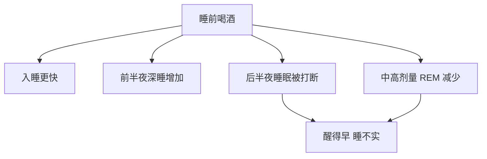

## Q
加班到半夜，你靠睡前两杯酒才睡得着，可凌晨 3 点总会醒。酒到底是在帮你睡，还是在拆你的睡眠？

## A
**酒精、睡眠与情绪（alcohol and sleep）：酒让人更快睡着，却把后半夜的睡眠打碎；酒精使用障碍和抑郁互相把对方的风险翻倍。**

**故事。** 2013 年，Ebrahim、Shapiro、Williams 和 Fenwick 把睡眠实验室里的研究汇总成一篇综述：健康志愿者睡前喝酒，用脑电图记录整夜。不管剂量多少，入睡都变快，前半夜睡得更连贯、慢波睡眠（深睡）增加；后半夜的睡眠被打断。中等和高剂量时，整夜的快速眼动睡眠（REM）占比下降，第一段 REM 也来得更晚。2011 年 Boden 和 Fergusson 汇总流行病学研究：酒精使用障碍或重度抑郁，任一个出现，另一个的风险就翻倍（合并后的校正比值比 2.00 到 2.09）。

- **证据 · 强：** 睡眠的部分是综述实验室里的健康志愿者，方向很一致；抑郁的部分最可能的方向是酒精推高抑郁，而不是反过来，但这是推论，不是随机试验的结果。
- **动手：** 接下来两周做个对照：一周完全不喝，一周照旧。每天早上记两个数：夜里醒了几次、起床时的精力 1 到 5 分。两周后把两组数字放在一起看。
