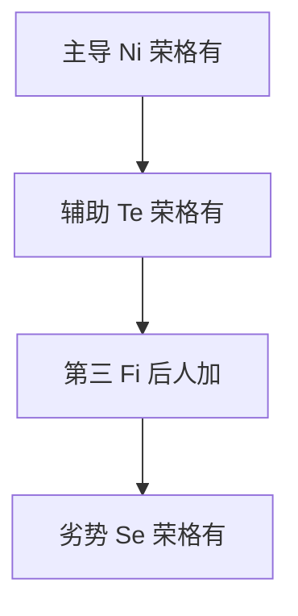

## Q
网上说「INTJ 的功能栈是 Ni–Te–Fi–Se」，还说 Ni 是你的「主导功能」，Se 是「劣势功能」。Ni、Te 这些八个字母是荣格定的吗？谁排的这个顺序？

## A
**八维与功能栈（eight functions and the function stack）：思维、情感、感觉、直觉各分内倾外倾得 8 种功能，这是荣格的；每个类型按「主导、辅助、第三、劣势」排成固定一列，是后人在荣格之上搭的模型。**

**故事。** 荣格 1921 年的《心理类型》里，有一节叫「主要功能和辅助功能」：他写，意识里总有一种功能最分化，另一种次要的功能「始终存在」，起辅助作用；思维型可以配直觉或感觉，但配不了情感，因为情感与思维对立。他也谈劣势功能，就是被压抑得最深的那个。但他没有给每个类型排出固定的四位次序，也没有 16 型的对照表：这套排法来自 Myers 母女的类型动力学（type dynamics），第三功能在中年才发展的说法也在其中；Beebe 又把八种功能排成「英雄、父母、孩子、劣势」等八个原型角色。

- **证据 · 弱：** 八维是荣格的概念，栈是模型。Reynierse 在 Journal of Psychological Type 上检验类型动力学，结论是它「靠轶事、过不了多数有效性检验、也不符合经验事实」。
- **动手：** 看到有人用「Ni 主导」解释一个人，先问：这句话预测了什么他接下来会做的事？预测不出来，就把它当语言游戏。
