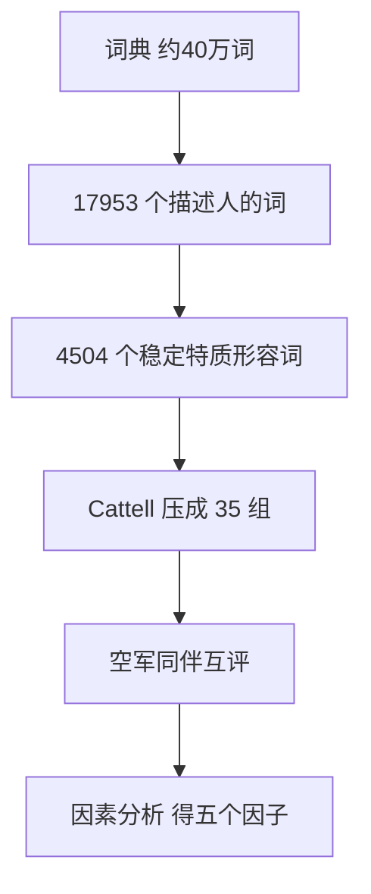

## Q
有人说性格测试都是拍脑袋编的维度。大五的「五个」是谁定的？是理论家规定的，还是别的办法得到的？

## A
**词汇假说（lexical hypothesis）：重要的性格差异都会变成日常语言里的词。把描述人的词拿去做因素分析，几十年、好几批人里反复得到五个大维度，不是谁规定的。**

**故事。** 1936 年 Allport 和 Odbert 从 Webster 词典里挑出 17,953 个描述人的词，其中 4,504 个形容词指向相对稳定的特质。Cattell 把它们压成 35 组词。Tupes 和 Christal 在 1950 年代末让美国空军官员互相打分，因素分析得到五个因子：外倾（Surgency）、宜人性、可靠性、情绪稳定、文化。1963 年 Norman 重做，得到同样五个，改名为外向、尽责等。Goldberg 1981 年把它叫作「大五」。

- **证据 · 强：** 五因子在英语的多批样本里一再出现。但换语言不是处处是五个：2004 年 Ashton 等人对七种语言的词汇研究，更常得到六个因子，多出的一个见 HEXACO 那张卡。
- **谁在用：** Costa 和 McCrae 的 NEO PI-R（1992）是据此做的问卷，每个维度下分 6 个侧面。
- **动手：** 下次有人说「性格测试是编的」，问他用的是哪套：从词典里统计出来的五维，和拍脑袋分的 16 型，不是一回事。
