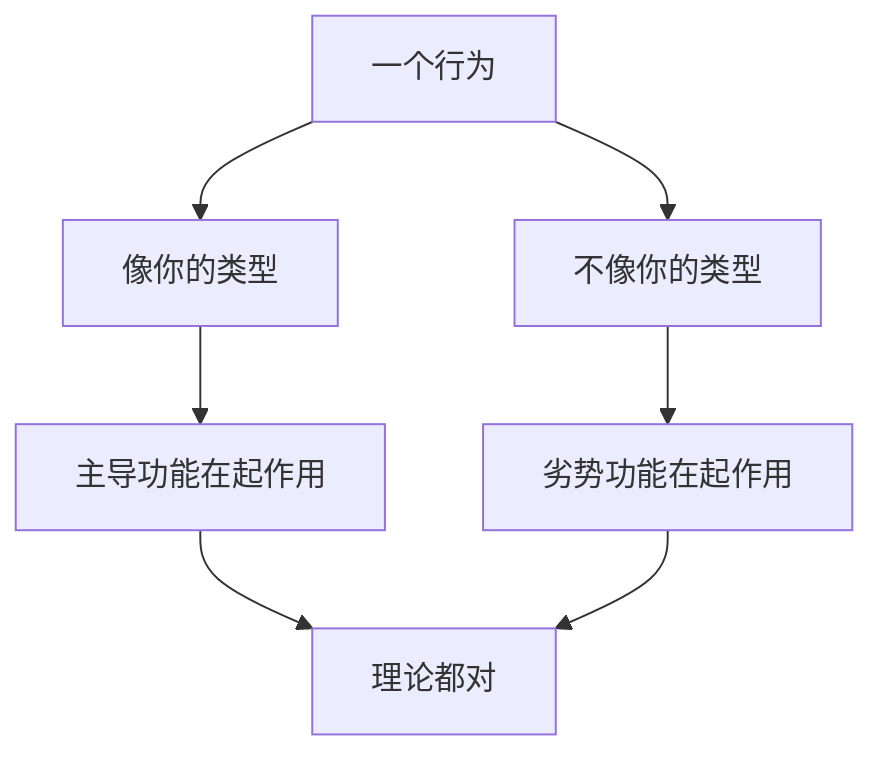

## Q
你是「INTJ」。你周末在家看书，论坛说这是 Ni 主导。你周末去了个吵闹的聚会，论坛说这是劣势功能 Se 发作。不管你做什么，这套说法都解释得通。这算好理论吗？

## A
**不可证伪（unfalsifiable）：一个理论能解释任何行为，说明它没有对世界下过赌注，也就无从被检验。**

**故事。** 1919 年，年轻的 Karl Popper 向 Alfred Adler 讲了一个病例，在他看来并不像 Adler 的理论，Adler 却毫不费力地用自卑感解释了它，连孩子都没见过。Popper 问他怎么这么肯定，Adler 说：「因为我积累了上千次的经验。」Popper 忍不住回了一句：那加上这一回，就是第一千零一次了。Popper 后来在《猜想与反驳》里写了两个例子：一个人把孩子推进水里想淹死他，另一个人舍命去救孩子。Adler 说两人都是自卑，Freud 说一个是压抑、一个是升华。Popper 想不出任何一种人类行为，是这两套理论解释不了的。他的结论是：理论「永远吻合」，正是它的弱点。

- **证据 · 弱：** 这是对类型动力学的论证，不是对荣格全部理论的判决：只有能说出「什么结果会证明我错」的版本，才能被检验。
- **动手：** 下次有人用功能栈解释你，先问：「如果我做了相反的事，这套理论会怎么解释？」两个方向都解释得通，就当作聊天的话题，不要当结论去做决定。
