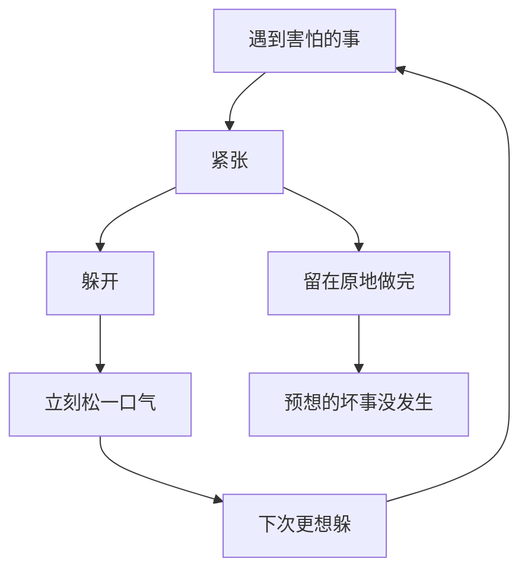

## Q
你怕在站会上发言，于是总等别人先说完、没事不开口。每次躲过去，当场松了一口气。半年后你发现，发言反而更吓人了。躲开明明让你舒服，为什么害怕反而变大？怎么才能让它缩回去？

## A
**回避与暴露（avoidance and exposure）：躲开害怕的事，当下的轻松会奖励「躲」这个动作，害怕就被养大；一点点去接触，才会让它变小。**

**故事。** 瑞典的 Öst 在 1989 年发表了一组 20 名特定恐惧症患者的「单次治疗」：只做一次，最长 3 小时，里面有治疗师示范、患者亲自去接触怕的东西，再核对「会出事」的预期。随访时，90% 的人明显好转或完全康复。

- **证据 · 强：** 2008 年 Wolitzky-Taylor 汇总 33 项随机对照试验：针对特定恐惧症，暴露疗法比不治疗效果大，也比安慰剂和其他疗法好。Öst 那一组是没有对照组的临床系列。Craske 2014 年的「抑制性学习」解释说，要紧的不是练到不紧张，而是让「我会出丑」这类预测被现实推翻。
- **动手：** 先写下你回避的事，列 5 步，从最轻的开始（比如在群聊里先回一句）。每一步之前写下预测：「我发言后，会发生___，概率 ___%」，做完记下实际发生了什么。本周做第一步，下次站会前做第二步。
