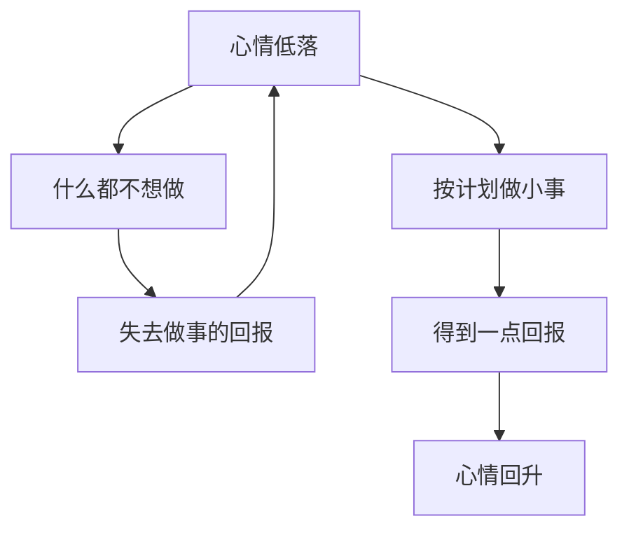

## Q
连着几周下班后你只想瘫在沙发上刷手机，健身、约朋友、周末出门都推掉了，打算「等心情好点再说」。心情一直没好。要等心情先好，还是可以反过来？一个没受过多少训练的人带着你做，够不够？

## A
**行为激活（behavioral activation）：低落时别等有心情再做事，先按排好的计划去做，情绪跟在行动后面。**

**故事。** 2012 到 2014 年，英国 Devon、Durham 和 Leeds 的初级诊所和心理治疗机构里，440 名确诊抑郁的成年人被随机分到两组：221 人由初级心理健康工作者带着做行为激活，219 人由受过完整训练的心理治疗师做认知行为疗法（CBT）。行为激活就是和来访者一起把每周的活动排进日程，去做以前在乎的事。12 个月后，两组的抑郁分数都是 8.4 分（PHQ-9），差 0.1 分，行为激活不比 CBT 差；它对带的人的训练要求更低、花费更少。

- **证据 · 强：** 这是 2016 年 Lancet 上的 COBRA 试验。更早，1996 年 Jacobson 把 CBT 拆开：只做行为激活的组，效果和完整认知治疗没有差别。2006 年 Dimidjian 等 241 人的试验里，病情较重的人用行为激活和用抗抑郁药效果相当，两者都好于认知治疗。
- **动手：** 本周日晚上先在日历上排 3 件下周的事（一次运动、一次见人、一件以前喜欢的小事），写明几点、在哪。到点就去做，不先问自己想不想去。
