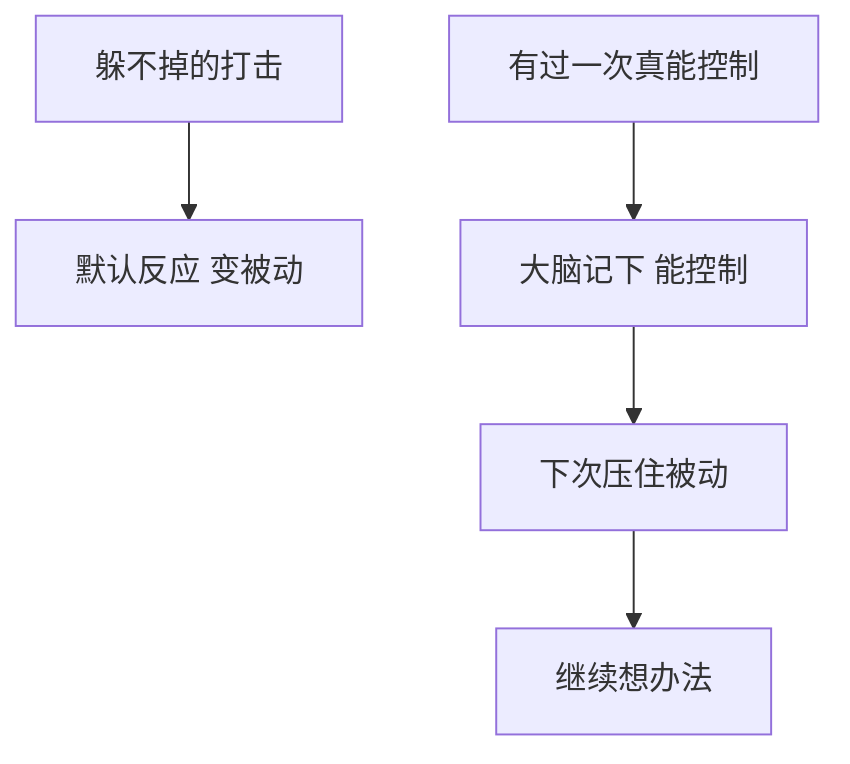

## Q
你连续三次面试挂在最后一轮，现在连投简历都提不起劲：「反正也没用。」这种被动是学来的吗？怎么扭回来？

## A
**习得性无助（learned helplessness）：被动不是学来的，是面对长期逆境的默认反应；要学的是「我能控制」。**

**故事。** 1967 年，Seligman 和 Maier 把狗分三组：一组挨电击时用鼻子推一块板就能关掉；一组配对挨完全一样的电击，怎么动都没用；一组不挨电击。第二天进穿梭箱，跳过矮隔板就能躲开电击。能自己关电击的狗和没挨电击的狗约 90% 很快学会；躲不掉那组约三分之二趴着不动，不去学。两人当时的解释是狗「学会了无助」。2016 年，他们根据几十年的大鼠实验改口：被动是长期电击下的默认反应，要学的是控制，前额叶察觉到「我的动作管用」，才把被动压下去；先体验过控制的动物，之后遇到躲不掉的打击也不容易垮。

- **证据 · 中：** 动物现象重复得很好。新解释的神经机制来自大鼠，作者自己说证据强但不算定论，在人身上只有少量研究。
- **动手：** 本周排 3 件结果全由你决定的小事：一天修掉一个 bug、约一个前同事喝咖啡、做一次模拟面试并拿到反馈。每做完一件，写一行「我做了 X，结果是 Y」。
